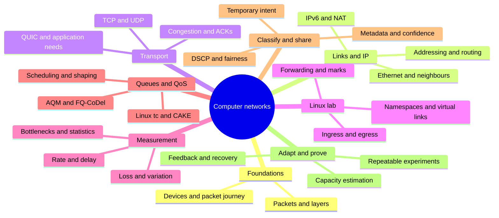

# Computer networking learning map

[Back to the project README](../../README.md)

A connected learning path from computer-networking fundamentals to the Adaptive QoS project: **67 topics across 8 branches**. Every topic includes an explanation, an example, a practice exercise, a self-check answer, prerequisite links and related topics.

## Choose a learning format

- **Read on GitHub:** select a topic in the [clickable topic index](#clickable-topic-index). Links jump to its lesson in this README.
- **Use the interactive mind map:** download [mindmap.html](mindmap.html) using GitHub’s Download raw file action, then open the downloaded file in a browser. It includes branch navigation, cross-links, self-checks and browser-local progress.
- GitHub displays HTML source rather than running this interactive map inside the README. The lessons below remain fully readable and navigable on GitHub.

The suggested route assumes some CN familiarity and limited Linux networking practice. Revisit prerequisites whenever a topic feels unfamiliar. The topic map is a learning recommendation, not an additional organizer requirement.

## Mind map

The diagram gives the overview. The links below are the navigation for every lesson.

## Clickable topic index

- **[1. Foundations](#branch-foundations)**
  - [What is a network?](#topic-network)
  - [Packets & switching](#topic-packets)
  - [Clients & servers](#topic-client-server)
  - [LAN, WAN & Internet](#topic-lan-wan)
  - [Network layers](#topic-layers)
  - [Encapsulation](#topic-encapsulation)
  - [Switch, router & AP](#topic-devices)
  - [Follow one packet](#topic-journey)
- **[2. Links & IP](#branch-addressing)**
  - [Ethernet & MAC](#topic-ethernet)
  - [IPv4 & subnets](#topic-ipv4)
  - [Routes & gateways](#topic-routing)
  - [ARP & neighbours](#topic-neighbors)
  - [IPv6 basics](#topic-ipv6)
  - [DHCP](#topic-dhcp)
  - [DNS](#topic-dns)
  - [MTU & MSS](#topic-mtu)
  - [NAT & conntrack](#topic-nat)
- **[3. Transport](#branch-transport)**
  - [TCP versus UDP](#topic-tcp-udp)
  - [Ports & five-tuples](#topic-ports)
  - [TCP reliability](#topic-reliability)
  - [Flow control](#topic-flow-control)
  - [TCP congestion](#topic-congestion)
  - [ACKs & both directions](#topic-ack-path)
  - [TLS, QUIC & VPNs](#topic-quic)
  - [Calls, games & video](#topic-applications)
- **[4. Linux lab](#branch-linux)**
  - [Linux essentials](#topic-shell)
  - [Interfaces & routes](#topic-linux-addresses)
  - [Network namespaces](#topic-namespaces)
  - [veth & bridges](#topic-veth)
  - [Forwarding & return path](#topic-forwarding)
  - [Hooks & marks](#topic-hooks)
  - [Ingress, egress & IFB](#topic-ingress)
  - [Build the first lab](#topic-linux-lab)
- **[5. Measurement](#branch-measurement)**
  - [Bits, bytes & rates](#topic-packet-rates)
  - [Delay & RTT](#topic-delay)
  - [Jitter & loss](#topic-jitter-loss)
  - [Bandwidth–delay product](#topic-bdp)
  - [Counters & telemetry](#topic-counters)
  - [ping, iperf & Flent](#topic-tools)
  - [Percentiles & repeat runs](#topic-tail-stats)
  - [Find the bottleneck](#topic-bottlenecks)
- **[6. Queues & QoS](#branch-qos)**
  - [Bufferbloat](#topic-bufferbloat)
  - [FIFO & tail drop](#topic-fifo)
  - [Scheduling & fairness](#topic-scheduling)
  - [Token buckets](#topic-token-bucket)
  - [Shaping versus policing](#topic-shaping)
  - [AQM & ECN](#topic-aqm)
  - [FQ-CoDel](#topic-fq-codel)
  - [tc objects](#topic-tc-objects)
  - [HTB & class rates](#topic-htb)
  - [CAKE](#topic-cake)
- **[7. Classify & share](#branch-classification)**
  - [Allowed metadata](#topic-metadata)
  - [Windows & features](#topic-windows)
  - [Confidence & correction](#topic-confidence)
  - [DSCP & trust](#topic-dscp)
  - [Device versus flow](#topic-host-fairness)
  - [Temporary intent](#topic-intent)
  - [Ground truth & accuracy](#topic-labels)
- **[8. Adapt & prove](#branch-adaptation)**
  - [Estimate capacity](#topic-capacity)
  - [Smoothing & EWMA](#topic-ewma)
  - [Hysteresis & cooldown](#topic-hysteresis)
  - [State & recovery](#topic-rollback)
  - [The control loop](#topic-controller)
  - [Controlled impairments](#topic-netem)
  - [Fair comparisons](#topic-experiments)
  - [Reproduce & reset](#topic-reproducibility)
  - [Project readiness](#topic-project-proof)

## How the branches connect to the project

| Branch | Project outcome |
| --- | --- |
| [1. Foundations](#branch-foundations) | Defines the devices, edge, network and applications in your project architecture. |
| [2. Links & IP](#branch-addressing) | Makes traffic traverse the gateway and keeps IPv4/IPv6 classification and device identity meaningful. |
| [3. Transport](#branch-transport) | Supports meaningful traffic categories, realistic workload generation and correct policy explanations. |
| [4. Linux lab](#branch-linux) | Implements the reference gateway, metadata collection path and enforcement mechanism. |
| [5. Measurement](#branch-measurement) | Supplies the dashboard, estimator inputs and acceptance metrics. |
| [6. Queues & QoS](#branch-qos) | Provides the policy mechanisms that protect interaction while keeping bulk traffic moving. |
| [7. Classify & share](#branch-classification) | Implements traffic classification, user intent, fairness and starvation prevention. |
| [8. Adapt & prove](#branch-adaptation) | Implements the adaptive engine and provides the evidence requested by the brief. |

## Guided route

Read in index order, or follow each lesson’s **Builds on** and **Connects to** links. A topic is understood when you can explain it, predict its example and complete the exercise.

**First milestone:** build a client–Linux gateway–server path, run a transfer through it, measure latency before and during load, and explain both packet directions.

## 1. Foundations

**Start with the packet journey.** A computer network lets programs exchange information through links and forwarding devices. Begin with what a packet is, then follow it from an application to a remote application. Each later topic will attach to a part of this journey.

**Branch exercise:** Draw a laptop, switch or access point, router, ISP and server. Label the links and identify which devices forward frames or packets.

**Project connection:** Defines the devices, edge, network and applications in your project architecture.

### 1.1 What is a network?

**A network connects programs and devices.** A network is a set of connected devices that exchange information using agreed rules called protocols. Links carry signals; hosts run applications; forwarding devices move traffic toward its destination. A connection can work without public Internet access.

**Example:** A client and server inside one Linux computer can communicate through virtual links.

**Try it:** Name the hosts, links and forwarding devices in your proposed lab.

**Self-check:** Does every network require the Internet?

Show explanation

No. A private or virtual network can connect its own hosts without a public Internet connection.

**Connects to:** [LAN, WAN & Internet](#topic-lan-wan) · [Build the first lab](#topic-linux-lab)

**Go deeper:** [Protocol practice: Kurose & Ross labs](https://gaia.cs.umass.edu/kurose_ross/wireshark.php)

[Topic index](#clickable-topic-index) · [Next topic](#topic-packets)

---

### 1.2 Packets & switching

**Large messages travel as smaller units.** Applications produce data that the network carries in packets. Packet switching lets many communications share a link over time. A forwarding device may temporarily queue a packet when its outgoing link is busy. Packets are not guaranteed to arrive together or with identical delay.

**Example:** A large download creates many packets. A small call packet can arrive while those packets are waiting.

**Try it:** Sketch two senders sharing one outgoing link and show where a queue could form.

**Self-check:** Why can a small message wait behind a large transfer?

Show explanation

They may share a busy link and queue. The scheduling and queue-management rules determine how they compete.

**Builds on:** [What is a network?](#topic-network)

**Connects to:** [Bufferbloat](#topic-bufferbloat) · [Scheduling & fairness](#topic-scheduling)

**Go deeper:** [Queuing disciplines: Systems Approach](https://book.systemsapproach.org/congestion/queuing.html)

[Previous topic](#topic-network) · [Topic index](#clickable-topic-index) · [Next topic](#topic-client-server)

---

### 1.3 Clients & servers

**Applications occupy the ends of the path.** A client initiates an application exchange and a server provides a service. These are roles, not fixed types of computer. A host can run both roles. The network transports their packets; it does not automatically understand what the application considers important.

**Example:** An iperf3 server receives test traffic from an iperf3 client.

**Try it:** Identify the client and server for a download and for your test workload.

**Self-check:** Can one laptop be both client and server?

Show explanation

Yes. Different processes on the same host can take different roles.

**Builds on:** [What is a network?](#topic-network)

**Connects to:** [Ports & five-tuples](#topic-ports) · [ping, iperf & Flent](#topic-tools)

**Go deeper:** [Protocol practice: Kurose & Ross labs](https://gaia.cs.umass.edu/kurose_ross/wireshark.php)

[Previous topic](#topic-packets) · [Topic index](#clickable-topic-index) · [Next topic](#topic-lan-wan)

---

### 1.4 LAN, WAN & Internet

**Your gateway sits between different networks.** A LAN connects nearby devices under local administration. A WAN connects networks over a wider area. The Internet interconnects many networks. Your home gateway connects a local network to an access connection, but a bottleneck may exist on either side or farther along the path.

**Example:** Excellent Wi-Fi does not remove a congested ISP link; excellent WAN capacity does not remove Wi-Fi interference.

**Try it:** Mark the LAN, gateway and emulated WAN on your topology.

**Self-check:** Where should you look if only wireless clients perform badly?

Show explanation

Investigate the wireless link and local conditions before assuming that the WAN queue is responsible.

**Builds on:** [What is a network?](#topic-network)

**Connects to:** [Switch, router & AP](#topic-devices) · [Find the bottleneck](#topic-bottlenecks)

**Go deeper:** [Protocol practice: Kurose & Ross labs](https://gaia.cs.umass.edu/kurose_ross/wireshark.php)

[Previous topic](#topic-client-server) · [Topic index](#clickable-topic-index) · [Next topic](#topic-layers)

---

### 1.5 Network layers

**Layers separate different responsibilities.** Use the TCP/IP model: application, transport, Internet and link. Applications define meaning; transport supports communication between processes; IP moves packets across networks; the link moves data to a neighbouring interface. The OSI model adds detail, but the packet path matters more than memorizing names.

**Example:** HTTP data can travel through TCP, inside IP, inside an Ethernet frame.

**Try it:** Place HTTP, TCP, UDP, IP and Ethernet into their layers.

**Self-check:** Which layer normally selects the next router?

Show explanation

The Internet or network layer uses IP routing. Ethernet only reaches a neighbour on the current link.

**Builds on:** [Packets & switching](#topic-packets)

**Connects to:** [Encapsulation](#topic-encapsulation) · [Routes & gateways](#topic-routing)

**Go deeper:** [Protocol practice: Kurose & Ross labs](https://gaia.cs.umass.edu/kurose_ross/wireshark.php)

[Previous topic](#topic-lan-wan) · [Topic index](#clickable-topic-index) · [Next topic](#topic-encapsulation)

---

### 1.6 Encapsulation

**Headers carry instructions for different layers.** Each layer wraps data with information needed for its job. Ethernet uses link addresses; IP uses network addresses; TCP and UDP use ports. A router forwards an IP packet onto a new link with a new link-layer frame. NAT may also change selected IP or transport fields.

**Example:** The destination MAC on a remote-server request is initially the gateway MAC, while the destination IP is the server IP.

**Try it:** Draw frame, IP packet and TCP segment as nested boxes and label their addresses.

**Self-check:** Does a remote server’s MAC address travel across every router?

Show explanation

No. Link-layer addressing is used for the current link and changes as routers forward onto other links.

**Builds on:** [Network layers](#topic-layers)

**Connects to:** [Ethernet & MAC](#topic-ethernet) · [NAT & conntrack](#topic-nat)

**Go deeper:** [Protocol practice: Kurose & Ross labs](https://gaia.cs.umass.edu/kurose_ross/wireshark.php)

[Previous topic](#topic-layers) · [Topic index](#clickable-topic-index) · [Next topic](#topic-devices)

---

### 1.7 Switch, router & AP

**Different forwarding devices make different decisions.** A switch or bridge forwards Ethernet frames within a link-layer network. A router forwards IP packets between networks. An access point connects wireless clients to a LAN. One home box can combine all these roles plus NAT, DHCP and firewall functions.

**Example:** Your Linux gateway needs routing and queueing; it does not have to emulate a Wi-Fi radio.

**Try it:** Split the features of a home router into switching, routing, wireless and services.

**Self-check:** Is a switch’s forwarding decision the same as a router’s?

Show explanation

No. A typical Ethernet switch uses MAC information; a router uses an IP routing table.

**Builds on:** [Network layers](#topic-layers)

**Connects to:** [Ethernet & MAC](#topic-ethernet) · [Routes & gateways](#topic-routing) · [veth & bridges](#topic-veth)

**Go deeper:** [Protocol practice: Kurose & Ross labs](https://gaia.cs.umass.edu/kurose_ross/wireshark.php)

[Previous topic](#topic-encapsulation) · [Topic index](#clickable-topic-index) · [Next topic](#topic-journey)

---

### 1.8 Follow one packet

**Connect all the layers in one explanation.** A program writes data to a socket. Transport adds its information, IP selects a route, neighbour discovery identifies the local next hop, and the interface transmits. Routers repeat forwarding decisions. The destination delivers data to the intended process. Replies need their own valid path.

**Example:** A test packet travels from a client namespace through your gateway namespace to a server namespace.

**Try it:** Explain the outward and return journey without looking at notes.

**Self-check:** At what point could your project delay or prioritize this packet?

Show explanation

At an enforcement point through which it actually passes, such as an outgoing gateway queue.

**Builds on:** [Encapsulation](#topic-encapsulation) · [Switch, router & AP](#topic-devices)

**Connects to:** [Build the first lab](#topic-linux-lab) · [Ingress, egress & IFB](#topic-ingress) · [tc objects](#topic-tc-objects)

**Go deeper:** [Linux packet path: Netfilter hooks](https://wiki.nftables.org/wiki-nftables/index.php/Netfilter_hooks)

[Previous topic](#topic-devices) · [Topic index](#clickable-topic-index) · [Next topic](#topic-ethernet)

---

## 2. Links & IP

**Make the path work.** Connect local delivery to IP routing. Learn how a host chooses a next hop, how it discovers that neighbour, and how addresses or packet sizes can change along the path.

**Branch exercise:** Build two subnets joined by a Linux gateway. Verify both directions before adding shaping.

**Project connection:** Makes traffic traverse the gateway and keeps IPv4/IPv6 classification and device identity meaningful.

### 2.1 Ethernet & MAC

**Local delivery uses link addresses.** Ethernet frames use MAC addresses for delivery across a local link. A bridge learns where source MAC addresses appear and uses that information for forwarding. Broadcast and unknown destinations behave differently from known unicast. MAC identity is local to the link, not an Internet-wide route.

**Example:** The laptop addresses an off-subnet packet’s frame to its gateway.

**Try it:** Inspect a test frame’s source and destination MAC addresses.

**Self-check:** Why can the frame target the gateway while IP targets the server?

Show explanation

The gateway is the next link-layer recipient; the server remains the IP destination.

**Builds on:** [Switch, router & AP](#topic-devices) · [Encapsulation](#topic-encapsulation)

**Connects to:** [ARP & neighbours](#topic-neighbors) · [Routes & gateways](#topic-routing)

**Go deeper:** [Protocol practice: Kurose & Ross labs](https://gaia.cs.umass.edu/kurose_ross/wireshark.php)

[Previous topic](#topic-journey) · [Topic index](#clickable-topic-index) · [Next topic](#topic-ipv4)

---

### 2.2 IPv4 & subnets

**A prefix identifies a network range.** An IPv4 address is 32 bits. CIDR notation adds a prefix length, such as /24, to identify a network range. Hosts use route information to decide whether delivery is local or requires a gateway. An address alone does not establish reachability.

**Example:** 10.0.1.10/24 and 10.0.2.20/24 normally require routing between their subnets.

**Try it:** Choose non-overlapping prefixes for the two sides of your virtual gateway.

**Self-check:** Does the same first octet guarantee two hosts are on one subnet?

Show explanation

No. The prefix length and routing configuration determine the network boundaries.

**Builds on:** [Network layers](#topic-layers)

**Connects to:** [Routes & gateways](#topic-routing) · [Interfaces & routes](#topic-linux-addresses)

**Go deeper:** [Protocol practice: Kurose & Ross labs](https://gaia.cs.umass.edu/kurose_ross/wireshark.php)

[Previous topic](#topic-ethernet) · [Topic index](#clickable-topic-index) · [Next topic](#topic-routing)

---

### 2.3 Routes & gateways

**Forwarding chooses a next hop.** A routing table maps destination prefixes to next hops and outgoing interfaces. Longest-prefix matching selects the most specific applicable route. A default route handles destinations without a more specific match. Each direction needs a usable route; enabling forwarding does not create those routes.

**Example:** A server needs a route toward the client subnet through the gateway.

**Try it:** Inspect routes, predict a packet’s outgoing interface, then verify the prediction.

**Self-check:** Can a request succeed outward while its reply fails?

Show explanation

Yes. The reverse direction may lack a route or may be blocked.

**Builds on:** [IPv4 & subnets](#topic-ipv4)

**Connects to:** [Forwarding & return path](#topic-forwarding) · [Follow one packet](#topic-journey) · [NAT & conntrack](#topic-nat)

**Go deeper:** [Linux packet path: Netfilter hooks](https://wiki.nftables.org/wiki-nftables/index.php/Netfilter_hooks)

[Previous topic](#topic-ipv4) · [Topic index](#clickable-topic-index) · [Next topic](#topic-neighbors)

---

### 2.4 ARP & neighbours

**Resolve the next hop on the local link.** ARP resolves IPv4 neighbours to link-layer addresses on a local link. IPv6 uses Neighbor Discovery, which also supports other local-link functions. For an off-subnet destination, the host resolves its gateway neighbour rather than discovering the remote server’s MAC.

**Example:** The ARP table holds a gateway mapping, not the MAC of a server across the Internet.

**Try it:** Inspect neighbour entries before and after sending local test traffic.

**Self-check:** Will ARP discover a remote server through several routers?

Show explanation

No. ARP operates within the local link; routers handle the onward IP path.

**Builds on:** [Ethernet & MAC](#topic-ethernet) · [Routes & gateways](#topic-routing)

**Connects to:** [IPv6 basics](#topic-ipv6) · [Interfaces & routes](#topic-linux-addresses)

**Go deeper:** [Protocol practice: Kurose & Ross labs](https://gaia.cs.umass.edu/kurose_ross/wireshark.php)

[Previous topic](#topic-routing) · [Topic index](#clickable-topic-index) · [Next topic](#topic-ipv6)

---

### 2.5 IPv6 basics

**IPv6 needs its own working path.** IPv6 uses 128-bit addresses and prefix-based routing. Learn global or local addresses, link-local addresses, Neighbor Discovery and default routes. Rules and measurements must cover IPv6 where available; an IPv4-only classifier can miss another active traffic path.

**Example:** A dual-stack application may select IPv6 even when an IPv4 rule looks correct.

**Try it:** Inspect IPv6 addresses and routes, then repeat a representative test using IPv6.

**Self-check:** Does an IPv4 shaping classification rule automatically match IPv6?

Show explanation

Do not assume it does. Verify the rule family and actual packet treatment for both protocols.

**Builds on:** [IPv4 & subnets](#topic-ipv4) · [ARP & neighbours](#topic-neighbors)

**Connects to:** [Hooks & marks](#topic-hooks) · [Reproduce & reset](#topic-reproducibility)

**Go deeper:** [Protocol practice: Kurose & Ross labs](https://gaia.cs.umass.edu/kurose_ross/wireshark.php)

[Previous topic](#topic-neighbors) · [Topic index](#clickable-topic-index) · [Next topic](#topic-dhcp)

---

### 2.6 DHCP

**Address configuration can be automatic.** DHCP can supply a host with an address lease and configuration such as a default gateway and DNS servers. It is a configuration service, not the mechanism that forwards ordinary application packets. Static addresses are useful for an initial reproducible lab.

**Example:** A client can receive an IP lease but still have an incorrect gateway configuration.

**Try it:** Record which addresses and routes are static and which are dynamically assigned.

**Self-check:** Is DHCP necessary for your first isolated lab?

Show explanation

No. Static addressing can simplify the initial experiment; understand DHCP for real home-network deployment.

**Builds on:** [IPv4 & subnets](#topic-ipv4)

**Connects to:** [DNS](#topic-dns) · [Routes & gateways](#topic-routing)

**Go deeper:** [Protocol practice: Kurose & Ross labs](https://gaia.cs.umass.edu/kurose_ross/wireshark.php)

[Previous topic](#topic-ipv6) · [Topic index](#clickable-topic-index) · [Next topic](#topic-dns)

---

### 2.7 DNS

**Names and addresses are different concerns.** DNS resolves names to records, including addresses. It is separate from the route used to reach that address. Name-resolution failure can make an application appear disconnected even when IP connectivity works. DNS alone is not reliable ground truth for what service an encrypted flow carries.

**Example:** A server responds by IP while its name fails because name resolution is broken.

**Try it:** Compare a name-based connection with the equivalent address-based test.

**Self-check:** Does successful DNS resolution prove the server is reachable?

Show explanation

No. Resolution supplies information; routing, transport and the application still need to work.

**Builds on:** [Clients & servers](#topic-client-server) · [IPv4 & subnets](#topic-ipv4)

**Connects to:** [Ports & five-tuples](#topic-ports) · [Allowed metadata](#topic-metadata)

**Go deeper:** [Protocol practice: Kurose & Ross labs](https://gaia.cs.umass.edu/kurose_ross/wireshark.php)

[Previous topic](#topic-dhcp) · [Topic index](#clickable-topic-index) · [Next topic](#topic-mtu)

---

### 2.8 MTU & MSS

**Packet size can change performance.** MTU limits the IP-packet size supported by a link. TCP MSS concerns TCP payload per segment. Path MTU Discovery helps endpoints adapt to the path. Fragmentation, blocked signalling and encapsulation overhead can affect delivery, so keep packet-size assumptions visible in experiments.

**Example:** A tunnel adds headers and can reduce the usable packet size for the inner traffic.

**Try it:** Record interface MTUs and compare a small packet with a larger controlled test packet.

**Self-check:** Are MTU and TCP MSS identical?

Show explanation

No. MSS excludes IP and TCP headers, while MTU limits the packet carried by the link.

**Builds on:** [Encapsulation](#topic-encapsulation) · [IPv4 & subnets](#topic-ipv4)

**Connects to:** [TLS, QUIC & VPNs](#topic-quic) · [Bits, bytes & rates](#topic-packet-rates)

**Go deeper:** [Protocol practice: Kurose & Ross labs](https://gaia.cs.umass.edu/kurose_ross/wireshark.php)

[Previous topic](#topic-dns) · [Topic index](#clickable-topic-index) · [Next topic](#topic-nat)

---

### 2.9 NAT & conntrack

**Address translation changes what you observe.** NAT can rewrite addresses or ports as traffic crosses a boundary. Connection tracking associates packets with connection state, including the reverse direction. Classification before and after translation may see different identifiers. Host fairness depends on retaining a meaningful view of internal devices.

**Example:** Several home devices can share one public IPv4 address while their connections remain distinct.

**Try it:** Sketch one connection’s internal and translated five-tuples and its reverse path.

**Self-check:** Can a public source IP always identify a single household device?

Show explanation

No. NAT can hide multiple internal devices behind one public address.

**Builds on:** [Routes & gateways](#topic-routing) · [Ports & five-tuples](#topic-ports)

**Connects to:** [Hooks & marks](#topic-hooks) · [Device versus flow](#topic-host-fairness)

**Go deeper:** [Linux packet path: Netfilter hooks](https://wiki.nftables.org/wiki-nftables/index.php/Netfilter_hooks)

[Previous topic](#topic-mtu) · [Topic index](#clickable-topic-index) · [Next topic](#topic-tcp-udp)

---

## 3. Transport

**Understand the traffic you will protect.** Transport behaviour explains why calls, games, streaming and downloads respond differently to congestion. Study how traffic is delivered and controlled before designing categories for it.

**Branch exercise:** Compare a TCP transfer and a controlled UDP workload across the same bottleneck.

**Project connection:** Supports meaningful traffic categories, realistic workload generation and correct policy explanations.

### 3.1 TCP versus UDP

**Delivery services affect application behaviour.** TCP provides a reliable ordered byte stream and transport congestion control. UDP sends datagrams without supplying that complete service; an application may add reliability or congestion control itself. Neither choice removes network delay or guarantees that the application is interactive.

**Example:** A video application can use UDP while adapting its own sending rate.

**Try it:** List which delivery properties a download and a call need.

**Self-check:** Is every UDP flow unresponsive to congestion?

Show explanation

No. UDP has no built-in TCP-style control, but applications or transports built over UDP can implement their own.

**Builds on:** [Network layers](#topic-layers) · [Clients & servers](#topic-client-server)

**Connects to:** [TCP congestion](#topic-congestion) · [TLS, QUIC & VPNs](#topic-quic)

**Go deeper:** [Protocol practice: Kurose & Ross labs](https://gaia.cs.umass.edu/kurose_ross/wireshark.php)

[Previous topic](#topic-nat) · [Topic index](#clickable-topic-index) · [Next topic](#topic-ports)

---

### 3.2 Ports & five-tuples

**Identify transport traffic precisely.** Ports identify transport endpoints on hosts. A conventional directional flow key includes source IP, destination IP, source port, destination port and protocol. The reverse direction swaps endpoints. Ports are useful features but do not reliably identify every application.

**Example:** Several applications can use TCP port 443; a port-only classifier cannot distinguish them all.

**Try it:** Write the five-tuple of a test connection and its reverse.

**Self-check:** Why is an IP address alone too coarse for a flow key?

Show explanation

A host may have many simultaneous connections to different processes and remote endpoints.

**Builds on:** [IPv4 & subnets](#topic-ipv4) · [Clients & servers](#topic-client-server)

**Connects to:** [NAT & conntrack](#topic-nat) · [Allowed metadata](#topic-metadata)

**Go deeper:** [Protocol practice: Kurose & Ross labs](https://gaia.cs.umass.edu/kurose_ross/wireshark.php)

[Previous topic](#topic-tcp-udp) · [Topic index](#clickable-topic-index) · [Next topic](#topic-reliability)

---

### 3.3 TCP reliability

**ACKs and retransmissions repair missing data.** TCP numbers stream bytes and uses acknowledgements to track delivery. Lost data can be retransmitted. Ordered delivery means missing earlier bytes can hold later data back from the application. Learn retransmission timeouts and duplicate acknowledgements at a conceptual level.

**Example:** A lost part of a download is retransmitted; completion can take longer even if the link rate is unchanged.

**Try it:** Observe ACKs and a controlled loss event in your test traffic.

**Self-check:** Does reliable delivery mean delivery without delay?

Show explanation

No. Repair and ordered delivery can add waiting time.

**Builds on:** [TCP versus UDP](#topic-tcp-udp) · [Ports & five-tuples](#topic-ports)

**Connects to:** [Flow control](#topic-flow-control) · [TCP congestion](#topic-congestion)

**Go deeper:** [Protocol practice: Kurose & Ross labs](https://gaia.cs.umass.edu/kurose_ross/wireshark.php)

[Previous topic](#topic-ports) · [Topic index](#clickable-topic-index) · [Next topic](#topic-flow-control)

---

### 3.4 Flow control

**Protect the receiver from excess data.** TCP’s receive window, rwnd, limits outstanding data according to receiver capacity. It is different from the congestion window, cwnd, which addresses network conditions. A slow receiver can limit throughput even when the network has spare capacity.

**Example:** A busy receiver may become the bottleneck in a throughput test.

**Try it:** Explain cwnd and rwnd as two separate restrictions on sending.

**Self-check:** Would increasing router capacity fix every low-throughput transfer?

Show explanation

No. The receiver, application, host CPU or sender can be limiting it.

**Builds on:** [TCP reliability](#topic-reliability)

**Connects to:** [TCP congestion](#topic-congestion) · [Find the bottleneck](#topic-bottlenecks)

**Go deeper:** [TCP congestion control: RFC 5681](https://www.rfc-editor.org/rfc/rfc5681.html)

[Previous topic](#topic-reliability) · [Topic index](#clickable-topic-index) · [Next topic](#topic-congestion)

---

### 3.5 TCP congestion

**The sender reacts to network evidence.** TCP congestion control limits outstanding data using cwnd and changes behaviour as acknowledgements and congestion signals arrive. Learn slow start, congestion avoidance and loss recovery conceptually. CUBIC and BBR use different strategies; a gateway scheduler is a separate mechanism from sender congestion control.

**Example:** After capacity falls, a transfer may build a queue before its sending behaviour adapts.

**Try it:** Describe what a sender may observe after loss, delay growth or ECN signalling.

**Self-check:** Does a router directly set the sender’s congestion window?

Show explanation

Normally it influences the sender through delivery and congestion signals; cwnd belongs to the sender’s transport implementation.

**Builds on:** [TCP reliability](#topic-reliability) · [Flow control](#topic-flow-control)

**Connects to:** [AQM & ECN](#topic-aqm) · [Estimate capacity](#topic-capacity)

**Go deeper:** [TCP congestion control: RFC 5681](https://www.rfc-editor.org/rfc/rfc5681.html)

[Previous topic](#topic-flow-control) · [Topic index](#clickable-topic-index) · [Next topic](#topic-ack-path)

---

### 3.6 ACKs & both directions

**Downloads depend on the return path too.** Acknowledgements and control messages use the reverse direction. Upload congestion can therefore affect a download or call. Your experiment should model and measure both directions rather than assuming only the direction carrying the large file matters.

**Example:** A cloud backup saturates upload while another device downloads data.

**Try it:** Run simultaneous uploads and downloads while observing latency and useful throughput.

**Self-check:** Why might limiting upload improve a download’s responsiveness?

Show explanation

It can reduce reverse-path queueing that delays ACKs or interactive control traffic.

**Builds on:** [TCP reliability](#topic-reliability) · [TCP congestion](#topic-congestion)

**Connects to:** [Ingress, egress & IFB](#topic-ingress) · [Fair comparisons](#topic-experiments)

**Go deeper:** [AQM evaluation: RFC 7928](https://www.rfc-editor.org/rfc/rfc7928.html)

[Previous topic](#topic-congestion) · [Topic index](#clickable-topic-index) · [Next topic](#topic-quic)

---

### 3.7 TLS, QUIC & VPNs

**Encryption limits application visibility.** TLS protects application communication. QUIC provides secure transport streams over UDP. VPNs can place different activities inside a tunnel. Visible headers, sizes and timing offer clues, but they do not guarantee exact application identity. Keep an unknown category and confidence.

**Example:** One encrypted connection or tunnel can carry traffic that needs different service treatment.

**Try it:** Identify which metadata your collector can use without reading private payloads.

**Self-check:** Does UDP port 443 prove a flow is gaming?

Show explanation

No. It can be QUIC traffic from many kinds of applications.

**Builds on:** [TCP versus UDP](#topic-tcp-udp) · [Ports & five-tuples](#topic-ports)

**Connects to:** [Allowed metadata](#topic-metadata) · [Confidence & correction](#topic-confidence)

**Go deeper:** [QUIC overview: RFC 9000](https://www.rfc-editor.org/rfc/rfc9000.html)

[Previous topic](#topic-ack-path) · [Topic index](#clickable-topic-index) · [Next topic](#topic-applications)

---

### 3.8 Calls, games & video

**Application needs should drive the policy.** Interactive applications care about delay, variation and timely delivery. Streaming often uses a playback buffer and bursty segment downloads. Bulk transfers care about completion and goodput. These are broad tendencies, not exact labels inferred from one packet.

**Example:** A streaming player can download a segment quickly, pause, then request another.

**Try it:** Write an objective for each of interactive, streaming and bulk traffic.

**Self-check:** Why should a call and a download not always receive identical treatment?

Show explanation

Their service needs differ. Delay protection can matter more than high bandwidth for an interactive exchange.

**Builds on:** [TCP versus UDP](#topic-tcp-udp) · [Delay & RTT](#topic-delay)

**Connects to:** [Scheduling & fairness](#topic-scheduling) · [Temporary intent](#topic-intent)

**Go deeper:** [DiffServ service classes: RFC 4594](https://www.rfc-editor.org/rfc/rfc4594.html)

[Previous topic](#topic-quic) · [Topic index](#clickable-topic-index) · [Next topic](#topic-shell)

---

## 4. Linux lab

**Make the theory observable.** Use a Linux VM and small virtual networks to practise. Verify forwarding first, then add measurement and traffic control. Each policy must act on a path that test packets really traverse.

**Branch exercise:** Build, inspect and reset an isolated client–gateway–server topology.

**Project connection:** Implements the reference gateway, metadata collection path and enforcement mechanism.

### 4.1 Linux essentials

**Learn enough Linux to debug the network.** Practise commands, paths, processes, exit codes, permissions and logs. Network configuration may require administrative capabilities. Separate reading state from changing state. A script should check failures and record what happened instead of assuming every command succeeded.

**Example:** A failed configuration command must not be logged as an applied policy.

**Try it:** Run a command, inspect its exit status and save its output with a timestamp.

**Self-check:** Why should a controller check return codes?

Show explanation

Otherwise it may report a policy that the system never applied.

**Builds on:** [What is a network?](#topic-network)

**Connects to:** [Interfaces & routes](#topic-linux-addresses) · [State & recovery](#topic-rollback)

**Go deeper:** [Linux traffic control reference](https://github.com/iproute2/iproute2/blob/main/man/man8/tc.8)

[Previous topic](#topic-applications) · [Topic index](#clickable-topic-index) · [Next topic](#topic-linux-addresses)

---

### 4.2 Interfaces & routes

**Inspect the actual Linux configuration.** Use ip link and ip addr for interfaces and addresses; ip route and ip -6 route for paths; ip neigh for neighbour state; ss for sockets. Distinguish an interface being up from having an address, a route and a working remote endpoint.

**Example:** An interface can be up while the server subnet has no route.

**Try it:** Read each interface and route in your lab and explain why it exists.

**Self-check:** Does an up interface prove end-to-end connectivity?

Show explanation

No. Addressing, routing, neighbour discovery, filtering and the remote host still matter.

**Builds on:** [Linux essentials](#topic-shell) · [Routes & gateways](#topic-routing)

**Connects to:** [Network namespaces](#topic-namespaces) · [Forwarding & return path](#topic-forwarding)

**Go deeper:** [Linux network namespaces](https://man7.org/linux/man-pages/man7/network_namespaces.7.html)

[Previous topic](#topic-shell) · [Topic index](#clickable-topic-index) · [Next topic](#topic-namespaces)

---

### 4.3 Network namespaces

**Create separate network environments.** A Linux network namespace has its own interfaces, routes, protocol stacks and other networking state. This lets one host represent several virtual network participants. The participants still share the physical machine’s computing resources, so lab performance has host limits.

**Example:** Client and gateway namespaces can have separate routing tables.

**Try it:** Create a minimal namespace lab and inspect routes within each participant.

**Self-check:** Do namespaces give each virtual host unlimited independent CPU?

Show explanation

No. Networking is isolated, but the participants still run on shared host resources.

**Builds on:** [Interfaces & routes](#topic-linux-addresses)

**Connects to:** [veth & bridges](#topic-veth) · [Build the first lab](#topic-linux-lab)

**Go deeper:** [Linux network namespaces](https://man7.org/linux/man-pages/man7/network_namespaces.7.html)

[Previous topic](#topic-linux-addresses) · [Topic index](#clickable-topic-index) · [Next topic](#topic-veth)

---

### 4.4 veth & bridges

**Connect virtual participants.** A veth pair acts like a virtual cable between interfaces. Moving endpoints into different namespaces connects their network environments. A bridge joins link-layer segments like a software switch. A routed gateway is a different role and needs IP forwarding.

**Example:** Two client namespaces can attach to a bridge on the LAN side of the gateway.

**Try it:** Draw which veth endpoint belongs to which namespace.

**Self-check:** Does adding a bridge automatically route between different IP networks?

Show explanation

No. A bridge forwards at the link layer; routing between networks requires routing configuration.

**Builds on:** [Network namespaces](#topic-namespaces) · [Switch, router & AP](#topic-devices)

**Connects to:** [Forwarding & return path](#topic-forwarding) · [Build the first lab](#topic-linux-lab)

**Go deeper:** [Linux network namespaces](https://man7.org/linux/man-pages/man7/network_namespaces.7.html)

[Previous topic](#topic-namespaces) · [Topic index](#clickable-topic-index) · [Next topic](#topic-forwarding)

---

### 4.5 Forwarding & return path

**Turn Linux into a router deliberately.** Forwarding allows packets not addressed to the Linux host itself to continue through it. Routes select paths, while filtering can permit or block them. Check the return direction independently. Keep the first lab routed and simple before introducing NAT.

**Example:** A client reaches the gateway, but forwarding is disabled and the remote server is unreachable.

**Try it:** Trace a request and reply through the gateway’s interfaces.

**Self-check:** Will enabling forwarding automatically create a server’s return route?

Show explanation

No. Route configuration and forwarding permission solve different problems.

**Builds on:** [Routes & gateways](#topic-routing) · [veth & bridges](#topic-veth)

**Connects to:** [Hooks & marks](#topic-hooks) · [Build the first lab](#topic-linux-lab)

**Go deeper:** [Linux packet path: Netfilter hooks](https://wiki.nftables.org/wiki-nftables/index.php/Netfilter_hooks)

[Previous topic](#topic-veth) · [Topic index](#clickable-topic-index) · [Next topic](#topic-hooks)

---

### 4.6 Hooks & marks

**Choose the correct place to apply a rule.** Forwarded packets follow prerouting, forward and postrouting hooks in the IP path. Locally generated traffic follows a different path. Packet marks are Linux metadata; DSCP is carried in the IP header. Connection marks can retain a decision across associated packets. Order and direction matter.

**Example:** A rule affecting gateway-originated traffic may miss clients’ forwarded traffic.

**Try it:** Annotate the packet path with where classification, NAT and marking happen.

**Self-check:** Are a Linux packet mark and DSCP the same field?

Show explanation

No. One is local packet metadata; the other is part of the IP header. Their policy mapping must be explicit.

**Builds on:** [Forwarding & return path](#topic-forwarding) · [NAT & conntrack](#topic-nat)

**Connects to:** [DSCP & trust](#topic-dscp) · [tc objects](#topic-tc-objects)

**Go deeper:** [Linux packet and connection marks](https://wiki.nftables.org/wiki-nftables/index.php/Setting_packet_metainformation)

[Previous topic](#topic-forwarding) · [Topic index](#clickable-topic-index) · [Next topic](#topic-ingress)

---

### 4.7 Ingress, egress & IFB

**Direction is relative to an interface.** Ingress means arriving at an interface; egress means leaving it. Linux shaping normally schedules transmission on egress. An IFB redirection can place incoming traffic into a queueing path for shaping. It cannot undo delay or loss already experienced before arrival.

**Example:** A home upload leaves the WAN interface; the download enters it.

**Try it:** Label ingress and egress for both directions on every gateway interface.

**Self-check:** Can shaping an arrived download packet remove its earlier ISP queueing delay?

Show explanation

No. It can influence subsequent delivery and transport behaviour, but it cannot reverse past delay.

**Builds on:** [Forwarding & return path](#topic-forwarding) · [ACKs & both directions](#topic-ack-path)

**Connects to:** [Shaping versus policing](#topic-shaping) · [tc objects](#topic-tc-objects)

**Go deeper:** [Ingress redirection and IFB](https://github.com/iproute2/iproute2/blob/main/man/man8/tc-mirred.8)

[Previous topic](#topic-hooks) · [Topic index](#clickable-topic-index) · [Next topic](#topic-linux-lab)

---

### 4.8 Build the first lab

**Combine forwarding, links and measurement.** Build a client, a Linux gateway and a server. Use separate subnets with clear routes. Prove both directions, run a transfer and inspect counters. Later add an independent WAN-emulator component so the controller and test condition remain separate.

**Example:** The emulator changes capacity; your gateway observes and responds without receiving the true rate as an input.

**Try it:** Save a topology diagram and a script that creates and resets the lab.

**Self-check:** Why keep the WAN emulator separate from the controller?

Show explanation

It prevents the system from changing or directly reading the condition used to evaluate its adaptation.

**Builds on:** [Network namespaces](#topic-namespaces) · [veth & bridges](#topic-veth) · [Forwarding & return path](#topic-forwarding)

**Connects to:** [ping, iperf & Flent](#topic-tools) · [Controlled impairments](#topic-netem) · [Fair comparisons](#topic-experiments)

**Go deeper:** [Linux network namespaces](https://man7.org/linux/man-pages/man7/network_namespaces.7.html)

[Previous topic](#topic-ingress) · [Topic index](#clickable-topic-index) · [Next topic](#topic-packet-rates)

---

## 5. Measurement

**Measure before you control.** A controller needs trustworthy observations. Learn rates, delay, loss and uncertainty, then collect reproducible evidence. High throughput alone is insufficient to describe responsiveness.

**Branch exercise:** Collect an idle baseline, saturate a known bottleneck, and compare time-series and tail measurements.

**Project connection:** Supplies the dashboard, estimator inputs and acceptance metrics.

### 5.1 Bits, bytes & rates

**Keep units and observation intervals explicit.** Bandwidth and throughput are often in bits per second; counters are often bytes. Compute a measured rate from a counter difference over elapsed time, multiplying bytes by eight for bits. Packet rate is another dimension: equal bit rates can involve very different packet-processing loads.

**Example:** 1 MB/s equals 8 Mbps when MB is decimal.

**Try it:** Calculate a rate from two byte-counter readings and their timestamps.

**Self-check:** Why can small packets use more CPU at the same Mbps?

Show explanation

More packets must be processed per second to carry the same amount of data.

**Builds on:** [Packets & switching](#topic-packets)

**Connects to:** [Counters & telemetry](#topic-counters) · [Find the bottleneck](#topic-bottlenecks)

**Go deeper:** [iperf3 documentation](https://software.es.net/iperf/invoking.html)

[Previous topic](#topic-linux-lab) · [Topic index](#clickable-topic-index) · [Next topic](#topic-delay)

---

### 5.2 Delay & RTT

**Separate transmission, propagation and waiting.** End-to-end delay includes transmission, propagation, processing and queueing. RTT measures a round trip, not a one-way journey. Compare idle and loaded conditions to look for extra delay, while remembering that the remote path and endpoint can also change.

**Example:** A nearby test server and a distant public server have different baseline delays.

**Try it:** Measure idle RTT, then RTT while a transfer runs.

**Self-check:** Is half of RTT always the true one-way delay?

Show explanation

No. The two directions may have different routes, queues or processing delays.

**Builds on:** [Follow one packet](#topic-journey) · [Bits, bytes & rates](#topic-packet-rates)

**Connects to:** [Bufferbloat](#topic-bufferbloat) · [Estimate capacity](#topic-capacity)

**Go deeper:** [AQM evaluation: RFC 7928](https://www.rfc-editor.org/rfc/rfc7928.html)

[Previous topic](#topic-packet-rates) · [Topic index](#clickable-topic-index) · [Next topic](#topic-jitter-loss)

---

### 5.3 Jitter & loss

**Define precisely what the tool reports.** Jitter describes delay variation, but different tools use different definitions. Packet loss counts missing deliveries according to a stated method and waiting threshold. TCP retransmissions and router drops are related observations, not interchangeable application-loss measurements.

**Example:** An AQM may drop some packets to improve overall latency and useful delivery.

**Try it:** Record the jitter definition, loss method and units used in one test.

**Self-check:** Is a router drop counter the same as a call’s packet-loss rate?

Show explanation

No. They describe different measurement points and traffic populations.

**Builds on:** [Delay & RTT](#topic-delay) · [TCP reliability](#topic-reliability)

**Connects to:** [AQM & ECN](#topic-aqm) · [Percentiles & repeat runs](#topic-tail-stats)

**Go deeper:** [Delay variation: RFC 5481](https://www.rfc-editor.org/rfc/rfc5481.html)

[Previous topic](#topic-delay) · [Topic index](#clickable-topic-index) · [Next topic](#topic-bdp)

---

### 5.4 Bandwidth–delay product

**Data in flight is different from queued data.** Bandwidth–delay product is bandwidth multiplied by RTT with consistent units. It helps reason about how much data can be in flight across a path. Do not confuse it with a recommendation to keep that much extra data waiting in a gateway queue.

**Example:** 100 Mbps multiplied by 50 ms is 5 megabits, or about 625 kB.

**Try it:** Compute BDP for two paths with equal bandwidth but different RTTs.

**Self-check:** Does a high BDP mean a router should deliberately maintain a large queue?

Show explanation

No. Data in flight along the path and extra waiting data in a queue are different.

**Builds on:** [Delay & RTT](#topic-delay) · [TCP congestion](#topic-congestion)

**Connects to:** [Bufferbloat](#topic-bufferbloat) · [Flow control](#topic-flow-control)

**Go deeper:** [TCP congestion control: RFC 5681](https://www.rfc-editor.org/rfc/rfc5681.html)

[Previous topic](#topic-jitter-loss) · [Topic index](#clickable-topic-index) · [Next topic](#topic-counters)

---

### 5.5 Counters & telemetry

**Measurements need time and context.** Read interface and qdisc counters at known intervals. Store direction, device, units and timestamps. Derive rates from differences; handle resets or recreated queues explicitly. Missing observations must be marked stale rather than silently interpreted as zero traffic.

**Example:** Replacing a queue may reset its counters and break a naive rate calculation.

**Try it:** Save a small time series of bytes, packets, backlog and observation time.

**Self-check:** What should you do with a negative counter difference?

Show explanation

Check for reset, replacement or parsing issues; do not report a physically negative traffic rate.

**Builds on:** [Bits, bytes & rates](#topic-packet-rates) · [Interfaces & routes](#topic-linux-addresses)

**Connects to:** [tc objects](#topic-tc-objects) · [Smoothing & EWMA](#topic-ewma)

**Go deeper:** [Linux traffic control reference](https://github.com/iproute2/iproute2/blob/main/man/man8/tc.8)

[Previous topic](#topic-bdp) · [Topic index](#clickable-topic-index) · [Next topic](#topic-tools)

---

### 5.6 ping, iperf & Flent

**Use complementary measurement tools.** Ping observes round-trip responses. iperf3 generates controlled transport workloads and measures their performance. Flent combines established load and latency tests. Each tool observes a specific behaviour; none alone measures every aspect of real application experience.

**Example:** Flent RRUL loads upload and download while observing latency.

**Try it:** Run one controlled transfer and collect latency alongside it.

**Self-check:** Why is ping without load insufficient for bufferbloat evaluation?

Show explanation

Queues may remain empty while idle and grow only when competing traffic loads the bottleneck.

**Builds on:** [Build the first lab](#topic-linux-lab) · [Delay & RTT](#topic-delay)

**Connects to:** [Fair comparisons](#topic-experiments) · [Jitter & loss](#topic-jitter-loss)

**Go deeper:** [Flent load and latency tests](https://flent.org/tests.html)

[Previous topic](#topic-counters) · [Topic index](#clickable-topic-index) · [Next topic](#topic-tail-stats)

---

### 5.7 Percentiles & repeat runs

**Look beyond one average.** Median describes the middle observation; p95 and p99 describe the upper tail. A time-series plot shows when conditions changed. Repeat runs to observe variation and keep raw data. A percentile value is meaningful only with its sampling method and measurement interval.

**Example:** Most packets arrive quickly, but occasional long waits raise p99 and disrupt interaction.

**Try it:** Plot a test’s RTT over time and calculate its median and p95.

**Self-check:** Can two runs share the same average but have different user experience?

Show explanation

Yes. One can be steady while the other has disruptive spikes.

**Builds on:** [Delay & RTT](#topic-delay) · [Jitter & loss](#topic-jitter-loss)

**Connects to:** [Fair comparisons](#topic-experiments) · [Project readiness](#topic-project-proof)

**Go deeper:** [AQM evaluation: RFC 7928](https://www.rfc-editor.org/rfc/rfc7928.html)

[Previous topic](#topic-tools) · [Topic index](#clickable-topic-index) · [Next topic](#topic-bottlenecks)

---

### 5.8 Find the bottleneck

**Low throughput has several possible causes.** A limiting resource can be the access link, Wi-Fi, a remote service, receiver, host CPU or your test environment. Distinguish capacity from offered load. A quiet 100 Mbps link carrying 5 Mbps is not evidence that the link only supports 5 Mbps.

**Example:** A Linux VM can become CPU-limited before an emulated link reaches its nominal rate.

**Try it:** List three possible explanations for an unexpectedly low test rate and a check for each.

**Self-check:** Can interface traffic volume alone reveal unused capacity?

Show explanation

No. Low demand leaves the maximum sustainable rate uncertain.

**Builds on:** [Bits, bytes & rates](#topic-packet-rates) · [Flow control](#topic-flow-control) · [LAN, WAN & Internet](#topic-lan-wan)

**Connects to:** [Estimate capacity](#topic-capacity) · [Reproduce & reset](#topic-reproducibility)

**Go deeper:** [AQM evaluation: RFC 7928](https://www.rfc-editor.org/rfc/rfc7928.html)

[Previous topic](#topic-tail-stats) · [Topic index](#clickable-topic-index) · [Next topic](#topic-bufferbloat)

---

## 6. Queues & QoS

**Control waiting and sharing.** Classification, scheduling, shaping and queue management have different jobs. Connect their behaviour to application outcomes before choosing a Linux configuration.

**Branch exercise:** Hold the traffic and bottleneck constant while comparing basic queueing with a competent fixed QoS configuration.

**Project connection:** Provides the policy mechanisms that protect interaction while keeping bulk traffic moving.

### 6.1 Bufferbloat

**Excess waiting can dominate the experience.** When arrivals exceed service for long enough, a queue grows. Persistent large queues add delay even when throughput is high. Approximate queueing delay as queued bits divided by service rate. Short bursts and persistent overload need different handling.

**Example:** One decimal MB waiting behind a 20 Mbps service rate takes about 400 ms to drain.

**Try it:** Create load and check whether extra delay rises with queue backlog.

**Self-check:** Can a connection deliver high Mbps and still feel unresponsive?

Show explanation

Yes. High throughput and excessive queueing delay can occur together.

**Builds on:** [Packets & switching](#topic-packets) · [Delay & RTT](#topic-delay)

**Connects to:** [FIFO & tail drop](#topic-fifo) · [AQM & ECN](#topic-aqm)

**Go deeper:** [Active queue management: RFC 7567](https://www.rfc-editor.org/rfc/rfc7567.html)

[Previous topic](#topic-bottlenecks) · [Topic index](#clickable-topic-index) · [Next topic](#topic-fifo)

---

### 6.2 FIFO & tail drop

**Scheduling and dropping are separate decisions.** FIFO serves packets in arrival order. Tail drop discards new arrivals when the buffer is full. They are often combined, but they solve different decisions. A queue can use a different scheduling order or an earlier congestion-signalling policy.

**Example:** A small interactive packet can wait behind a backlog of bulk packets in one FIFO.

**Try it:** Draw FIFO service order and show what happens at a full buffer.

**Self-check:** Is FIFO itself a complete description of the dropping policy?

Show explanation

No. FIFO describes service order; tail drop describes a particular decision about full buffers.

**Builds on:** [Bufferbloat](#topic-bufferbloat)

**Connects to:** [Scheduling & fairness](#topic-scheduling) · [AQM & ECN](#topic-aqm)

**Go deeper:** [Queuing disciplines: Systems Approach](https://book.systemsapproach.org/congestion/queuing.html)

[Previous topic](#topic-bufferbloat) · [Topic index](#clickable-topic-index) · [Next topic](#topic-scheduling)

---

### 6.3 Scheduling & fairness

**Choose who receives the next service opportunity.** Strict priority serves a preferred queue first and can starve others. Round robin shares opportunities; weighted schemes express unequal policies. Fair queueing separates flows. DRR accounts for variable packet sizes with service credits. Know the behaviour before tuning weights or priorities.

**Example:** One device with many connections can receive more total service under simple per-flow fairness.

**Try it:** Compare strict priority with a weighted policy in a drawing of three busy queues.

**Self-check:** Why must an important class still be bounded?

Show explanation

Unbounded preferred traffic can consume service continuously and starve other traffic.

**Builds on:** [FIFO & tail drop](#topic-fifo) · [Calls, games & video](#topic-applications)

**Connects to:** [Device versus flow](#topic-host-fairness) · [HTB & class rates](#topic-htb)

**Go deeper:** [Queuing disciplines: Systems Approach](https://book.systemsapproach.org/congestion/queuing.html)

[Previous topic](#topic-fifo) · [Topic index](#clickable-topic-index) · [Next topic](#topic-token-bucket)

---

### 6.4 Token buckets

**Rate and burst are different parameters.** A token bucket accumulates permission to transmit at a configured rate, up to a bucket size. A burst can use stored tokens; long-term behaviour remains rate-limited. Too little burst allowance or excessive buffering can change the intended result.

**Example:** A shaped flow may send a short burst faster than its long-term configured rate.

**Try it:** Explain rate, burst size and waiting time as separate settings.

**Self-check:** Does a 20 Mbps shaper forbid every brief interval above 20 Mbps?

Show explanation

Not necessarily. Burst behaviour depends on the shaper configuration and time scale.

**Builds on:** [Bits, bytes & rates](#topic-packet-rates) · [FIFO & tail drop](#topic-fifo)

**Connects to:** [Shaping versus policing](#topic-shaping) · [HTB & class rates](#topic-htb)

**Go deeper:** [Token Bucket Filter reference](https://github.com/iproute2/iproute2/blob/main/man/man8/tc-tbf.8)

[Previous topic](#topic-scheduling) · [Topic index](#clickable-topic-index) · [Next topic](#topic-shaping)

---

### 6.5 Shaping versus policing

**Control transmission or enforce a profile.** Shaping delays transmission to follow a rate profile. Policing checks conformance and may drop or remark traffic that exceeds it. Scheduling chooses which waiting packet goes next. These mechanisms can be combined, but a drop rule is not equivalent to a paced transmission queue.

**Example:** A shaper can spread a burst over time; a policer can discard excess packets.

**Try it:** Choose a mechanism for pacing a gateway’s outgoing connection and explain why.

**Self-check:** Will dropping excess packets always provide the same timing as shaping?

Show explanation

No. Shaping uses queueing and scheduled transmission; policing does not provide identical pacing.

**Builds on:** [Token buckets](#topic-token-bucket) · [Ingress, egress & IFB](#topic-ingress)

**Connects to:** [tc objects](#topic-tc-objects) · [AQM & ECN](#topic-aqm)

**Go deeper:** [Linux traffic control reference](https://github.com/iproute2/iproute2/blob/main/man/man8/tc.8)

[Previous topic](#topic-token-bucket) · [Topic index](#clickable-topic-index) · [Next topic](#topic-aqm)

---

### 6.6 AQM & ECN

**Signal persistent congestion before buffers stay full.** Active Queue Management decides when to signal congestion, commonly by dropping or marking packets. ECN allows a congestion indication when the path and transport support it. ECN is not a traffic-priority label. AQM works with transport responses and scheduling; it does not create capacity.

**Example:** Some congestion marks can accompany lower delay and better application behaviour.

**Try it:** Explain which observations you would use besides a drop counter to judge success.

**Self-check:** Does zero queue drops always mean a better policy?

Show explanation

No. A queue can avoid drops while imposing harmful delay. Judge useful delivery, latency and application loss together.

**Builds on:** [TCP congestion](#topic-congestion) · [FIFO & tail drop](#topic-fifo)

**Connects to:** [FQ-CoDel](#topic-fq-codel) · [DSCP & trust](#topic-dscp)

**Go deeper:** [Active queue management: RFC 7567](https://www.rfc-editor.org/rfc/rfc7567.html)

[Previous topic](#topic-shaping) · [Topic index](#clickable-topic-index) · [Next topic](#topic-fq-codel)

---

### 6.7 FQ-CoDel

**Combine flow scheduling and delay management.** FQ-CoDel hashes traffic into flow queues, gives sparse flows useful isolation, and runs CoDel queue management. It helps reduce interference from large flows. It is not the same as a complete integrated link-rate shaper, and its fairness unit is not automatically a household user.

**Example:** A sparse interactive flow can receive service without sitting behind an entire large transfer queue.

**Try it:** Compare fixed FQ-CoDel-based treatment with a basic FIFO case.

**Self-check:** Does choosing FQ-CoDel automatically determine the access link’s capacity?

Show explanation

No. Capacity estimation and any required shaping are separate design responsibilities.

**Builds on:** [Scheduling & fairness](#topic-scheduling) · [AQM & ECN](#topic-aqm)

**Connects to:** [CAKE](#topic-cake) · [Device versus flow](#topic-host-fairness)

**Go deeper:** [FQ-CoDel: RFC 8290](https://www.rfc-editor.org/rfc/rfc8290.html)

[Previous topic](#topic-aqm) · [Topic index](#clickable-topic-index) · [Next topic](#topic-tc-objects)

---

### 6.8 tc objects

**Translate the policy into Linux mechanisms.** A qdisc defines queueing behaviour. A class subdivides a classful configuration. Filters choose treatment and actions can mark, police or redirect. Handles identify pieces of the configuration. Inspect applied state and statistics instead of assuming a successful-looking command changed the right traffic.

**Example:** An HTB hierarchy can have FQ-CoDel leaf queues selected by filters.

**Try it:** Draw one root, its classes, filters and leaf queues, then inspect their counters.

**Self-check:** What is the difference between a class and a classifier?

Show explanation

A class is a subdivision of traffic treatment; classification is the decision assigning traffic to treatment.

**Builds on:** [Shaping versus policing](#topic-shaping) · [Hooks & marks](#topic-hooks)

**Connects to:** [HTB & class rates](#topic-htb) · [CAKE](#topic-cake) · [Counters & telemetry](#topic-counters)

**Go deeper:** [Linux traffic control reference](https://github.com/iproute2/iproute2/blob/main/man/man8/tc.8)

[Previous topic](#topic-fq-codel) · [Topic index](#clickable-topic-index) · [Next topic](#topic-htb)

---

### 6.9 HTB & class rates

**Allocate class service explicitly.** HTB is a classful bandwidth-control mechanism. Learn rate, ceiling, borrowing, burst and the leaf qdisc. A class’s ability to borrow depends on spare parent capacity. Child configurations must fit a coherent parent budget; exact service still depends on the full setup and traffic.

**Example:** A bulk class can borrow unused capacity when interactive traffic is quiet.

**Try it:** Explain what changes when rate stays fixed but ceiling increases.

**Self-check:** Does a high ceiling create bandwidth when the parent is saturated?

Show explanation

No. Borrowing requires capacity that the parent can provide.

**Builds on:** [Token buckets](#topic-token-bucket) · [tc objects](#topic-tc-objects)

**Connects to:** [Device versus flow](#topic-host-fairness) · [Temporary intent](#topic-intent)

**Go deeper:** [HTB reference](https://github.com/iproute2/iproute2/blob/main/man/man8/tc-htb.8)

[Previous topic](#topic-tc-objects) · [Topic index](#clickable-topic-index) · [Next topic](#topic-cake)

---

### 6.10 CAKE

**Study an integrated home-gateway scheduler.** CAKE integrates shaping, queue management, flow isolation and service differentiation. Learn configured bandwidth, host/flow fairness, DiffServ modes, overhead assumptions and statistics. Its class thresholds are not simply fixed bandwidth reservations. Dynamic rate selection still needs a justified approach.

**Example:** Your controller can update a CAKE rate while retaining an established scheduling mechanism.

**Try it:** Inspect a fixed CAKE configuration and explain each option you chose.

**Self-check:** Does enabling CAKE complete the adaptive QoS project?

Show explanation

No. You still need estimation, intent, confidence, corrections, recovery and measured evaluation.

**Builds on:** [FQ-CoDel](#topic-fq-codel) · [tc objects](#topic-tc-objects)

**Connects to:** [Estimate capacity](#topic-capacity) · [DSCP & trust](#topic-dscp) · [The control loop](#topic-controller)

**Go deeper:** [CAKE reference](https://github.com/iproute2/iproute2/blob/main/man/man8/tc-cake.8)

[Previous topic](#topic-htb) · [Topic index](#clickable-topic-index) · [Next topic](#topic-metadata)

---

## 7. Classify & share

**Connect observations to fair policy.** Use allowed metadata to infer broad service needs, expose uncertainty and permit correction. Connect those decisions to bounded priorities, device fairness and temporary user intent.

**Branch exercise:** Classify a controlled workload, change its treatment, correct a mistake and verify that another device keeps progressing.

**Project connection:** Implements traffic classification, user intent, fairness and starvation prevention.

### 7.1 Allowed metadata

**Use clues without reading private payloads.** Useful inputs include protocol, direction, counts, packet lengths, flow duration and timing summaries. Keep collection limited to what the policy needs. An IP address, port or a single small packet is weak evidence of application identity. Privacy includes minimizing stored identifiers as well as avoiding payload inspection.

**Example:** A sustained large transfer is a clue for bulk activity, but buffered streaming can look similar.

**Try it:** Write a collector schema containing only necessary metadata and units.

**Self-check:** Why keep an unknown class?

Show explanation

Some encrypted or unfamiliar traffic does not support a confident decision from allowed evidence.

**Builds on:** [Ports & five-tuples](#topic-ports) · [TLS, QUIC & VPNs](#topic-quic)

**Connects to:** [Windows & features](#topic-windows) · [Confidence & correction](#topic-confidence)

**Go deeper:** [QUIC overview: RFC 9000](https://www.rfc-editor.org/rfc/rfc9000.html)

[Previous topic](#topic-cake) · [Topic index](#clickable-topic-index) · [Next topic](#topic-windows)

---

### 7.2 Windows & features

**Summarize behaviour over time.** Group observations into a defined flow and time window. Calculate rates, variability, burstiness, direction ratios and duration using consistent units. Short windows respond quickly but can be noisy; longer windows smooth behaviour but delay recognition. Packet-level train/test mixing can leak the same session across evaluation sets.

**Example:** A momentary video segment burst should not automatically become a permanent bulk label.

**Try it:** Compare the same workload’s features over two window lengths.

**Self-check:** What trade-off changes when the window gets longer?

Show explanation

Estimates may become steadier, but decisions can react more slowly and combine different behaviours.

**Builds on:** [Allowed metadata](#topic-metadata) · [Counters & telemetry](#topic-counters)

**Connects to:** [Smoothing & EWMA](#topic-ewma) · [Ground truth & accuracy](#topic-labels)

**Go deeper:** [AQM evaluation: RFC 7928](https://www.rfc-editor.org/rfc/rfc7928.html)

[Previous topic](#topic-metadata) · [Topic index](#clickable-topic-index) · [Next topic](#topic-confidence)

---

### 7.3 Confidence & correction

**Treat a classification as a fallible decision.** Return a category, reason and uncertainty indicator. A heuristic score is not automatically a calibrated probability. Allow correction and define how long it applies. At low confidence, retain fair default service rather than assigning an unsupported extreme priority.

**Example:** A flow guessed as bulk is corrected to interactive and its queue treatment changes.

**Try it:** Create a deliberately ambiguous workload and document the fallback.

**Self-check:** Does a score of 0.8 always mean 80% correctness?

Show explanation

Only if that probability interpretation has been defined and validated. Otherwise describe it as a rule or model score.

**Builds on:** [Allowed metadata](#topic-metadata) · [Windows & features](#topic-windows)

**Connects to:** [Temporary intent](#topic-intent) · [Ground truth & accuracy](#topic-labels)

**Go deeper:** [AQM evaluation: RFC 7928](https://www.rfc-editor.org/rfc/rfc7928.html)

[Previous topic](#topic-windows) · [Topic index](#clickable-topic-index) · [Next topic](#topic-dscp)

---

### 7.4 DSCP & trust

**Service markings need a local policy.** DSCP expresses requested service treatment in the IP header. It is distinct from ECN congestion information and Linux-local marks. Define which markings you trust, how classification maps to treatment and what happens at boundaries. A marking is not an end-to-end performance guarantee.

**Example:** A device marking every transfer as high priority should not monopolize the gateway.

**Try it:** Map your broad categories to documented local treatments and define an unknown default.

**Self-check:** Will a remote network necessarily honour your DSCP?

Show explanation

No. Service handling can change across administrative domains; your strongest claim is about your tested enforcement scope.

**Builds on:** [Hooks & marks](#topic-hooks) · [AQM & ECN](#topic-aqm)

**Connects to:** [CAKE](#topic-cake) · [Temporary intent](#topic-intent)

**Go deeper:** [DiffServ service classes: RFC 4594](https://www.rfc-editor.org/rfc/rfc4594.html)

[Previous topic](#topic-confidence) · [Topic index](#clickable-topic-index) · [Next topic](#topic-host-fairness)

---

### 7.5 Device versus flow

**Choose the unit of fairness deliberately.** Per-flow fairness can favour a device that opens many connections. Per-device fairness needs a usable device identity, including awareness of NAT and changing addresses. Compare participants with similar demand when judging equal sharing; a low-rate call need not receive a download’s throughput.

**Example:** One laptop opens twenty downloads while a second opens one.

**Try it:** Test whether the first laptop gains an unintended total advantage.

**Self-check:** Is equal throughput for every application always fair?

Show explanation

No. Fairness depends on the policy and demand. Also measure useful delivery and starvation.

**Builds on:** [NAT & conntrack](#topic-nat) · [Scheduling & fairness](#topic-scheduling)

**Connects to:** [HTB & class rates](#topic-htb) · [Temporary intent](#topic-intent) · [Fair comparisons](#topic-experiments)

**Go deeper:** [FQ-CoDel: RFC 8290](https://www.rfc-editor.org/rfc/rfc8290.html)

[Previous topic](#topic-dscp) · [Topic index](#clickable-topic-index) · [Next topic](#topic-intent)

---

### 7.6 Temporary intent

**A preference needs scope, bounds and expiry.** Represent intent with a target, requested treatment, start, expiry and cancellation. Limit its resource effect so other traffic progresses. Prefer identifying the intended traffic when possible; a device-wide preference can otherwise promote an unrelated background transfer from that device.

**Example:** Prioritize a laptop’s call for 30 minutes, then restore normal treatment.

**Try it:** Apply a temporary preference while a second device downloads; test expiry and cancellation.

**Self-check:** Why should intent expire automatically?

Show explanation

Temporary importance should not silently become a permanent household priority.

**Builds on:** [Confidence & correction](#topic-confidence) · [Device versus flow](#topic-host-fairness) · [DSCP & trust](#topic-dscp)

**Connects to:** [State & recovery](#topic-rollback) · [The control loop](#topic-controller)

**Go deeper:** [DiffServ service classes: RFC 4594](https://www.rfc-editor.org/rfc/rfc4594.html)

[Previous topic](#topic-host-fairness) · [Topic index](#clickable-topic-index) · [Next topic](#topic-labels)

---

### 7.7 Ground truth & accuracy

**Evaluate recognition independently.** Use known generated workloads as labels, but keep labels out of classifier inputs. Hold out sessions or conditions, inspect per-class errors and report unknown coverage. A fixed test port can verify plumbing; memorizing it does not establish general recognition. ML is optional and must show useful benefit if used.

**Example:** A model scores well on packets from familiar sessions but fails on a new session.

**Try it:** Create a confusion matrix using held-out workload sessions.

**Self-check:** Why is a random packet split from one session risky?

Show explanation

Closely related observations can appear in training and testing, inflating the apparent ability to generalize.

**Builds on:** [Confidence & correction](#topic-confidence) · [Windows & features](#topic-windows)

**Connects to:** [Fair comparisons](#topic-experiments) · [Project readiness](#topic-project-proof)

**Go deeper:** [AQM evaluation: RFC 7928](https://www.rfc-editor.org/rfc/rfc7928.html)

[Previous topic](#topic-intent) · [Topic index](#clickable-topic-index) · [Next topic](#topic-capacity)

---

## 8. Adapt & prove

**Close the feedback loop.** Combine fresh measurements, uncertainty, a bounded policy and verification. Test whether the resulting service improves, and demonstrate predictable recovery when evidence or enforcement fails.

**Branch exercise:** Automate a capacity drop, recovery, wrong classification, intent expiry and an enforcement failure.

**Project connection:** Implements the adaptive engine and provides the evidence requested by the brief.

### 8.1 Estimate capacity

**Sustainable rate is an inference, not a counter.** Combine offered load, delivered rate, delay and queue evidence to estimate a sustainable shaping rate. Track upload and download separately and express uncertainty. Low demand does not reveal the maximum, and a remote delay change is not proof of local congestion.

**Example:** A quiet 100 Mbps link carrying 5 Mbps still has unknown spare capacity from counters alone.

**Try it:** List what additional evidence would support reducing a shaping rate.

**Self-check:** Should the emulator send its true capacity directly to the estimator?

Show explanation

No. Keep that value for evaluation ground truth if the estimator is supposed to infer conditions.

**Builds on:** [Find the bottleneck](#topic-bottlenecks) · [Delay & RTT](#topic-delay) · [Counters & telemetry](#topic-counters)

**Connects to:** [Smoothing & EWMA](#topic-ewma) · [The control loop](#topic-controller)

**Go deeper:** [Study an existing adaptive controller](https://github.com/lynxthecat/cake-autorate)

[Previous topic](#topic-labels) · [Topic index](#clickable-topic-index) · [Next topic](#topic-ewma)

---

### 8.2 Smoothing & EWMA

**Reduce noise while preserving useful changes.** A moving average summarizes recent observations. EWMA combines the current observation with a previous estimate using a weight. More smoothing can suppress spikes but delay detection. Mark stale data and consider a path’s baseline delay separately from its current loaded delay.

**Example:** One delayed probe should not force a dramatic rate change by itself.

**Try it:** Compare raw and smoothed delay during a short spike and a sustained capacity drop.

**Self-check:** Can heavy smoothing hide a real problem?

Show explanation

Yes. A response that is too slow may leave queues growing while the estimate catches up.

**Builds on:** [Counters & telemetry](#topic-counters) · [Windows & features](#topic-windows)

**Connects to:** [Hysteresis & cooldown](#topic-hysteresis) · [Estimate capacity](#topic-capacity)

**Go deeper:** [Study an existing adaptive controller](https://github.com/lynxthecat/cake-autorate)

[Previous topic](#topic-capacity) · [Topic index](#clickable-topic-index) · [Next topic](#topic-hysteresis)

---

### 8.3 Hysteresis & cooldown

**Avoid unstable switching.** Use distinct conditions for entering and leaving congestion states. A cooldown gives an applied action time to have an observable effect. Bounds and step limits reduce excessive changes. These controls trade adaptation speed against stability and must be tested with changing conditions.

**Example:** A controller repeatedly increases and decreases its rate around one noisy threshold.

**Try it:** Show how separate entry and exit thresholds would change that behaviour.

**Self-check:** Is the fastest reaction to every single observation always best?

Show explanation

No. Noise-driven reactions can cause oscillation and harm service.

**Builds on:** [Smoothing & EWMA](#topic-ewma) · [Estimate capacity](#topic-capacity)

**Connects to:** [The control loop](#topic-controller) · [Fair comparisons](#topic-experiments)

**Go deeper:** [Study an existing adaptive controller](https://github.com/lynxthecat/cake-autorate)

[Previous topic](#topic-ewma) · [Topic index](#clickable-topic-index) · [Next topic](#topic-rollback)

---

### 8.4 State & recovery

**Define what happens when automation fails.** Separate normal, congested, degraded-observation and fallback behaviour. Validate a candidate policy, apply it, then verify actual state. A previous configuration may be unsuitable after capacity changes; define a conservative fallback and report when assumptions fail. Never treat stale telemetry as reliable evidence.

**Example:** A policy operation fails while the link is already congested.

**Try it:** Simulate stale measurements or a rejected policy and check the resulting state.

**Self-check:** Is the last high-rate policy always safe to restore?

Show explanation

No. Current capacity may now be lower. Recovery must account for current conditions and documented bounds.

**Builds on:** [Linux essentials](#topic-shell) · [Temporary intent](#topic-intent) · [Estimate capacity](#topic-capacity)

**Connects to:** [The control loop](#topic-controller) · [Project readiness](#topic-project-proof)

**Go deeper:** [AQM evaluation: RFC 7928](https://www.rfc-editor.org/rfc/rfc7928.html)

[Previous topic](#topic-hysteresis) · [Topic index](#clickable-topic-index) · [Next topic](#topic-controller)

---

### 8.5 The control loop

**Connect measurement, decision and enforcement.** Collect fresh observations, update estimates, resolve intent and propose a policy. Check bounds and fairness, apply the policy, verify it, and observe the outcome. Record why the decision happened. Keep packet forwarding in the networking stack while higher-level logic uses aggregated observations.

**Example:** The controller changes a rate and then checks the installed configuration and subsequent service metrics.

**Try it:** Draw the complete loop and identify every input, output and failure path.

**Self-check:** Does a successful command prove the policy improved service?

Show explanation

No. It proves only part of enforcement; evaluate the resulting application and network metrics.

**Builds on:** [tc objects](#topic-tc-objects) · [Estimate capacity](#topic-capacity) · [Hysteresis & cooldown](#topic-hysteresis) · [State & recovery](#topic-rollback)

**Connects to:** [Controlled impairments](#topic-netem) · [Project readiness](#topic-project-proof)

**Go deeper:** [AQM evaluation: RFC 7928](https://www.rfc-editor.org/rfc/rfc7928.html)

[Previous topic](#topic-rollback) · [Topic index](#clickable-topic-index) · [Next topic](#topic-netem)

---

### 8.6 Controlled impairments

**Create repeatable conditions independently.** Use an emulator to introduce documented delay, loss and capacity conditions. Placement, queue configuration and kernel timing affect results. Keep the manipulated bottleneck separate from the gateway policy being evaluated. Save configurations and seeds where applicable.

**Example:** A test changes the WAN service rate while the gateway continues observing normally.

**Try it:** Create a resettable impairment scenario and state where it is applied.

**Self-check:** Why does impairment placement matter?

Show explanation

Different placements can interact differently with queues, transport behaviour and the measurements you collect.

**Builds on:** [Build the first lab](#topic-linux-lab) · [Delay & RTT](#topic-delay)

**Connects to:** [Fair comparisons](#topic-experiments) · [Reproduce & reset](#topic-reproducibility)

**Go deeper:** [netem reference](https://github.com/iproute2/iproute2/blob/main/man/man8/tc-netem.8)

[Previous topic](#topic-controller) · [Topic index](#clickable-topic-index) · [Next topic](#topic-experiments)

---

### 8.7 Fair comparisons

**Separate established QoS from your contribution.** Compare a basic baseline, competent fixed QoS and your adaptive version under comparable conditions. Repeat runs, save raw data and report variability. Measure interactive performance alongside bulk progress, fairness, stability and CPU overhead. Add component ablations if you claim a specific model provides the benefit.

**Example:** Adaptation helps a variable-rate case while fixed QoS already performs well at stable capacity.

**Try it:** Automate one scenario across the three configurations.

**Self-check:** What can a comparison only against poor FIFO fail to show?

Show explanation

It can hide how much improvement comes from an established scheduler rather than your new adaptive logic.

**Builds on:** [ping, iperf & Flent](#topic-tools) · [Percentiles & repeat runs](#topic-tail-stats) · [Controlled impairments](#topic-netem) · [Ground truth & accuracy](#topic-labels)

**Connects to:** [Reproduce & reset](#topic-reproducibility) · [Project readiness](#topic-project-proof)

**Go deeper:** [AQM evaluation: RFC 7928](https://www.rfc-editor.org/rfc/rfc7928.html)

[Previous topic](#topic-netem) · [Topic index](#clickable-topic-index) · [Next topic](#topic-reproducibility)

---

### 8.8 Reproduce & reset

**Evidence needs a documented environment.** Record OS, kernel, tools, topology, routes, queue settings, workloads and measurement definitions. Include reset and verification steps. Repeat representative IPv6 tests where available. Label synthetic traffic and emulation accurately and document licenses and known limits.

**Example:** A second person recreates the same capacity-drop experiment from your scripts and configuration.

**Try it:** Write a checklist for recreating one result on another Linux machine.

**Self-check:** Does a VM result prove production-router performance?

Show explanation

No. It establishes behaviour on the tested environment; hardware, drivers, offloads and resource limits need separate validation.

**Builds on:** [Build the first lab](#topic-linux-lab) · [IPv6 basics](#topic-ipv6) · [Fair comparisons](#topic-experiments)

**Connects to:** [Project readiness](#topic-project-proof) · [Find the bottleneck](#topic-bottlenecks)

**Go deeper:** [AQM evaluation: RFC 7928](https://www.rfc-editor.org/rfc/rfc7928.html)

[Previous topic](#topic-experiments) · [Topic index](#clickable-topic-index) · [Next topic](#topic-project-proof)

---

### 8.9 Project readiness

**Demonstrate the complete service outcome.** Show real traffic crossing your gateway, useful metadata classification with confidence and correction, changing-rate adaptation, temporary intent, fairness and recovery. Present latency, jitter, loss, throughput, queue and overhead evidence. AI is optional; if present, show measurable value over deterministic logic.

**Example:** A scripted demonstration resets the lab, runs the scenario and produces a comparison report.

**Try it:** Perform a call-like workload plus bulk transfer, a capacity drop, intent expiry and a failure-recovery test.

**Self-check:** What should a reviewer be able to reproduce?

Show explanation

The tested condition, applied decisions, measured outcome and important limitations of your implementation.

**Builds on:** [The control loop](#topic-controller) · [Fair comparisons](#topic-experiments) · [Reproduce & reset](#topic-reproducibility)

**Connects to:** [Follow one packet](#topic-journey) · [Device versus flow](#topic-host-fairness) · [Ground truth & accuracy](#topic-labels)

**Go deeper:** [AQM evaluation: RFC 7928](https://www.rfc-editor.org/rfc/rfc7928.html)

[Previous topic](#topic-reproducibility) · [Topic index](#clickable-topic-index)

---
