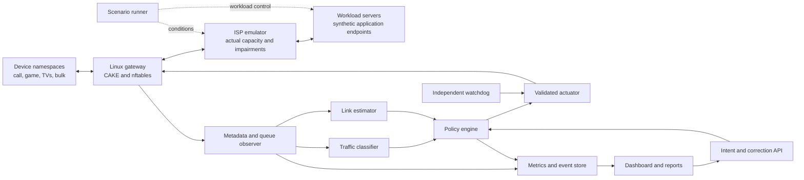

**Adaptive QoS: implementation plan from the current repository to a reproducible demonstration**

[Project README](../README.md) · [CN learning map](cn-learning/README.md)

Prepared on 3 November 2026. This is a proposed implementation plan, not a claim that the software or its benchmarks already exist. The reviewed local checkout and GitHub `main` were at `a0d0abde2e01e411f39aad16742050141198d08c`; they contained documentation and the learning map, with no QoS application yet.

The requirements below come from the supplied **Case Study 3 — Adaptive QoS Engine for Mixed Home Broadband Traffic**, pages 2–3. Tool choices, algorithms, sample workloads, numerical targets and estimates of effort are engineering recommendations. The brief does not mandate a particular framework, machine-learning model or numerical performance threshold.

**The intended result:** a Linux gateway observes traffic without inspecting application content, estimates changing link conditions, controls real queues, accepts temporary user priorities, and produces evidence of its performance and recovery behavior.

**Recommended route:** Python control software around Linux CAKE, nftables and conntrack, demonstrated first in an isolated Linux network-namespace lab. Start with deterministic decisions. Add AI only after the deterministic system works and there is a measurable reason to use it.

<a name="route"></a>

**Implementation route**

1. [Turn the brief into acceptance checks](#step-1).
2. [Prepare a Linux environment and repository structure](#step-2).
3. [Build a routed lab with a separate ISP emulator](#step-3).
4. [Generate workloads and measure the uncontrolled baseline](#step-4).
5. [Implement and verify static QoS enforcement](#step-5).
6. [Collect metadata and expose honest traffic classifications](#step-6).
7. [Estimate changing link conditions](#step-7).
8. [Build the bounded adaptive policy loop](#step-8).
9. [Add temporary user intent and correction](#step-9).
10. [Implement independent recovery and rollback](#step-10).
11. [Build the API, dashboard and event history](#step-11).
12. [Automate experiments and produce the evidence](#step-12).
13. [Package setup, limitations, licenses and the demonstration](#step-13).

Each step includes a completion gate. Reach the gate before treating that component as finished.

<a name="step-1"></a>

**1. Turn the brief into acceptance checks**

Start with `docs/requirements.md`. Give each requirement an ID and connect it to software and a reproducible check.

**Step-01 update, 4 November 2026:** [Requirements and acceptance checks](requirements.md) now defines the source mapping, scope, module contracts, procedures and evidence for this project. Its metric definitions and PT01-PT09 targets are the current acceptance criteria; they formalize or extend the initial numerical suggestions later in this plan. The documentation step is complete; runtime checks remain **Not run**.

| Required behavior or evidence | Implementation responsibility | Demonstration that should exist |
| --- | --- | --- |
| Broad traffic classification without reading private payloads | Metadata observer and classifier | Classification output, confidence, unknown cases, correction and evaluation against separately held workload labels |
| Link-capacity estimator | Per-direction link estimator | Known emulated capacity changes compared with estimates, with uncertainty and low-demand periods identified |
| Dynamic queueing and shaping through an open mechanism | Policy engine and Linux actuator | Inspectable `tc` state, actual rate changes and counter changes on the intended interfaces |
| Temporary service intent | Intent API and expiring policy state | Create, cancel and automatically expire a priority; show competing traffic still progresses |
| IPv4 and IPv6 where available | Routing, collection, marking and enforcement | Both families traverse the gateway and appear in counters, classifications and experiments |
| Rollback and a safe failure state | Actuator, watchdog and persisted configuration | Invalid policy, stale telemetry and controller-crash tests |
| Latency, jitter, loss, throughput, queue depth and fairness dashboard | Collector, API and dashboard | Charts computed from actual recorded measurements with units and timestamps |
| Baseline-versus-optimized automated experiments | Scenario runner and report generator | One command creates the lab, runs comparable modes, collects evidence and generates a report |
| Architecture and setup guide | Documentation | Device, edge, network, analytics, data and UI components; exact tested versions and verification commands |
| Reproducibility, licenses and limitations | Packaging and reporting | Workload definitions, seeds, configs, dependency licenses, emulation labels and an explicit production gap |

The ISO-download/call, bandwidth-drop, and TV/gaming examples are illustrative scenarios. Reproducing all three is a good project demonstration choice, rather than an extra claim about what the brief mandates.

Define the MVP as all required modules working with controlled synthetic traffic. Genuine WebRTC calls, real router hardware, advanced packet features, QUIC-specific experiments and ML are later extensions. Synthetic traffic must be identified as synthetic in the interface and report.

**Completion gate:** every required behavior has an owner module and an evidence artifact. There are no invented benchmark results or unsupported claims about recognizing particular apps.

<a name="step-2"></a>

**2. Prepare a Linux environment and repository structure**

Because the current development machine is Windows and Linux practice is limited, use an Ubuntu VM with a normal Linux kernel as the reference lab. Ubuntu 24.04 LTS is a reasonable fixed starting environment; record the exact installed image, kernel and package versions. A planning allocation is 4 virtual CPUs, 6–8 GB RAM and 30 GB disk, adjusted to the machine available. These are development estimates, not minimum requirements from the brief.

WSL can be an alternate development environment after checking its kernel, CAKE/IFB availability, namespace permissions and repeatable results. It should not silently replace the documented reference environment. Ubuntu's official documentation provides the [network administration starting point](https://ubuntu.com/server/docs/how-to/networking/).

**Step-02 update, 4 November 2026:** the dedicated VirtualBox VM, installer and preflight now exist. Follow the [setup guide](setup.md) and inspect the [actual environment manifest](environments/ubuntu-24.04-virtualbox.json). The selected VM has 4 vCPUs, 3 GiB RAM and a 30 GiB virtual disk; 34 capability checks passed with one resource warning. This verifies Linux facilities and temporary namespace inspection/cleanup, not the later QoS controller or benchmark targets. The application skeleton and permanent Python environment are checklist step 03.

Inside the Linux VM, install the initial tools:

```bash
sudo apt update
sudo apt install -y git python3 python3-venv python3-pip \
  iproute2 nftables conntrack iperf3 iputils-ping \
  ethtool jq sysstat
```

Run a preflight that checks privileges, executables, required kernel facilities and available resources. Module availability varies with the kernel; `sch_cake`, `sch_fq_codel`, `sch_htb`, `sch_netem`, `ifb` and `nf_conntrack` must be available as built-ins or modules. Loading an absent module is a preflight failure to resolve, not a reason to continue with fake measurements.

Record at least:

```bash
uname -a
cat /etc/os-release
tc -V
nft --version
conntrack -V
iperf3 --version
python3 --version
```

Create the environment manifest from the working VM, rather than copying versions from a plan. Pin Python dependencies after testing them there. Use a virtual environment. Keep the controller mostly standard-library Python initially; introduce FastAPI, a schema validator, pytest, psutil and matplotlib only where they serve the API, validation, testing, overhead measurement or reports.

Suggested structure; these files are proposed and are not implemented merely by appearing here:

```text
adaptive-qos/
  README.md
  pyproject.toml
  configs/
    lab.yaml
    controller.yaml
    safe-policy.yaml
  lab/
    preflight.sh
    up.sh
    down.sh
    inspect.sh
    isp_profile.sh
  src/adaptive_qos/
    models.py
    observer.py
    classifier.py
    estimator.py
    policy.py
    actuator.py
    intents.py
    watchdog.py
    controller.py
    storage.py
    api.py
  workloads/
    udp_echo.py
    paced_stream.py
    burst_download.py
  experiments/
    scenarios/
    run.py
    analyze.py
    report.py
  ui/
  tests/
    unit/
    integration/
  results/
    .gitkeep
  docs/
    requirements.md
    architecture.md
    setup.md
    limitations.md
    third-party-licenses.md
    cn-learning/
```

Define shared data records before connecting modules: `FlowWindow`, `Classification`, `LinkEstimate`, `Intent`, `Policy`, `ApplyResult`, `MetricSample` and `Event`. Include an explicit schema version, measurement timestamp, freshness and units. An absent measurement is `null` or unavailable, never automatically zero.

**Checklist step-03 update, 4 November 2026:** the installable package, record validation, clock/context checks, configuration separation, examples and distribution checks are now implemented. Use the [development guide](development.md) and [phase-3 verification record](environments/phase-03-verification.json). Controller algorithms and actual queue enforcement remain later work. The VM was recovered from a boot clock stall using one vCPU; the current test report records that profile separately from the historical phase-2 snapshot.

**Completion gate:** the preflight succeeds in the documented VM, all versions are recorded, and the team can explain interfaces, routes, forwarding, namespaces and the two traffic directions. Use the learning map's Linux and measurement branches while completing this step.

<a name="step-3"></a>

**3. Build a routed lab with a separate ISP emulator**

Use network namespaces: each has its own network stack, routes and interfaces. Connect them with veth pairs. This is an inspectable way to emulate multiple devices without buying routers or IoT equipment. The namespace model and lifecycle are documented in [`ip-netns`](https://man7.org/linux/man-pages/man8/ip-netns.8.html).

Begin with one client and expand after routing works:

```text
qos-client:c0 <-> lan0:qos-gw:wan0 <-> gw0:qos-isp:srv0 <-> s0:qos-server

Client             Your gateway       ISP emulator        Test endpoints
                   Controller owns    Runner owns         Traffic generation
                   these policies     these conditions    and measurements
```

Use these initial routed IPv4 networks, without NAT:

| Link | Left address | Right address |
| --- | --- | --- |
| Client ↔ gateway | client `10.10.0.2/24` | gateway `lan0:10.10.0.1/24` |
| Gateway ↔ ISP | gateway `wan0:10.20.0.1/30` | ISP `gw0:10.20.0.2/30` |
| ISP ↔ server | ISP `srv0:10.30.0.1/24` | server `10.30.0.2/24` |

Set client default route through `10.10.0.1`, gateway default through `10.20.0.2`, ISP route to `10.10.0.0/24` through `10.20.0.1`, and server default through `10.30.0.1`. Enable IPv4 forwarding inside `qos-gw` and `qos-isp`; bring every namespace loopback and link up. These assignments agree with the implemented `configs/lab.yaml`.

Add IPv6 in this lab early: `fd42:ad:10::/64`, `fd42:ad:20::/64` and `fd42:ad:30::/64` are the implemented networks for the same three links, with equivalent forward and return routes and IPv6 forwarding. ULA addressing is sufficient for an isolated IPv6 demonstration. No public IPv6 subscription is necessary for this local test. Preserve Neighbor Discovery and Packet Too Big traffic when installing filtering rules.

Then replace the single-client link with a Linux bridge in a dedicated `qos-lan` namespace. Attach separate clients for call-like traffic, gaming-like traffic, TVs and bulk transfer. A device then has its own IP identity. Three streams from one namespace are three flows, not three household devices.

Make `lab/up.sh` create only resources with the project prefix and record what it owns. Make `lab/down.sh` terminate tracked workload processes and remove only those resources. Re-running setup should either reconcile a known lab or fail clearly; it must not duplicate links or leave stale policy state.

The single-client and four-device bridge topologies support scripted setup, inspection, IPv4/IPv6 transfer verification, and cleanup. Private namespace bind mounts preserve ownership because an unpinned inode can be reused after deletion. [Routed lab guide](routed-lab.md) · [Step 4 verification](environments/phase-04-verification.json)

**Separate two different kinds of shaping:**

- **Actual emulated capacity:** owned by the scenario runner in `qos-isp`. Download bottleneck on `gw0` egress toward the gateway; upload bottleneck on `srv0` egress toward the server. A one-class HTB rate limiter with a deliberately documented FIFO leaf can model a slower provider link.
- **Gateway's chosen shaper rates:** owned by the controller in `qos-gw`. Upload on `wan0` egress; download on `lan0` egress toward clients.

Start with 100 Mbit/s download and 20 Mbit/s upload as a chosen scenario configuration. The emulator's actual rates, queue limits and future change times must not be available to the controller process. Only the runner and post-run analyzer may read them. Reading a shared scenario file would invalidate the capacity-estimation demonstration.

Optional propagation delay/loss should be added in a separately documented impairment stage. Validate its placement and achieved delay before measuring algorithms. [`netem`](https://man7.org/linux/man-pages/man8/tc-netem.8.html) documents timer, qdisc-composition and TCP Small Queues limitations; its receiver-ingress guidance matters for realistic TCP tests. Do not accidentally replace the capacity or CAKE qdisc when adding delay.

Step 05 implements the two ISP limits with HTB and FIFO queues. The runner verifies rates in the kernel, changes the classes on a monotonic schedule, and records actual transition times in a root-only journal. The packaged profiles exercise a drop and recovery in each direction. [ISP emulation guide](isp-emulation.md)

**Completion gate:** IPv4/IPv6 ping, upload and download traverse both routed namespaces; return paths work; changing the ISP rate changes achievable throughput; reset restores the same topology. `inspect.sh` prints addresses, routes, forwarding flags and queue state.

<a name="architecture"></a>

**The complete architecture to implement**



The controller handles decisions on sampled statistics. Packet forwarding, queue management and packet marking stay in the Linux kernel. Avoid a Python userspace forwarding path.

<a name="step-4"></a>

**4. Generate workloads and measure the uncontrolled baseline**

Before making traffic better, prove that you can generate contention and measure its effects. Start with `iperf3` TCP upload/download and simultaneous latency probes. The official [iperf3 manual](https://software.es.net/iperf/invoking.html) documents UDP tests, reverse mode for downloads and JSON results. Run separate server processes/ports for concurrent tests where the installed version requires it. Ordinary `-J` output arrives at completion; use supported streaming output or other collectors for live metrics.

Example commands, **after the proposed topology exists**, executed inside the Linux VM:

```bash
# Terminal 1: server; stop it explicitly after the test.
sudo ip netns exec qos-server iperf3 -s -p 5201

# Terminal 2: a 60-second download.
sudo ip netns exec qos-client iperf3 \
  -c 10.30.0.2 -p 5201 -R -t 60 -J

# Terminal 3: observe latency during the transfer.
sudo ip netns exec qos-client ping -n -i 0.2 10.30.0.2
```

Use IPv6 versions as a separate check. The commands in this document have been researched but have not been executed in the current Windows workspace.

Build small controlled workload generators as needed:

| Workload | Chosen initial behavior | What it can demonstrate |
| --- | --- | --- |
| Call-like | Bidirectional paced UDP, e.g. 1–3 Mbit/s, configurable packet size and timing | Delivery, delay variation and loss under load; not codec quality or genuine video conferencing |
| Game-like | Small request/reply datagrams, e.g. 50 requests/s with sequence numbers | Application RTT, response deadlines and lost replies; not a real game's quality |
| TV-like | Three separate clients fetching segments at target rates, e.g. 4 Mbit/s each | Completion deadlines and an explicitly modeled playback buffer; not Netflix detection |
| Bulk | Backlogged TCP transfers with repeatable durations or byte counts | Useful goodput and whether lower-priority traffic makes progress |
| Unknown/ambiguous | Encrypted-looking generic TCP/UDP patterns and multiplexed traffic | Safe default behavior and classifier limitations |

The endpoints may process synthetic sequence numbers/timestamps in traffic they themselves generate. The gateway classifier must not read those payload fields. Keep workload labels, process names and ground-truth identities out of the runtime classification features.

Use monotonic time for elapsed durations. RTT needs no cross-machine clock synchronization. If reporting one-way delay, verify clock alignment and state the method and uncertainty; do not divide RTT by two and label it a measured one-way delay.

Log a quiet period, then add load, then stop it. Verify that your provider FIFO can produce observable delay when overloaded. If it does not, inspect placement, queue size and actual offered load rather than inventing a bufferbloat result.

**Completion gate:** saved raw data shows the traffic rate, interactive probe behavior, queue evolution and application delivery for an uncontrolled run. Each measured quantity has a definition and a collector.

<a name="step-5"></a>

**5. Implement and verify static QoS enforcement**

Use CAKE for the main implementation. It already provides shaping, active queue management, flow isolation and Diffserv service classes; your project work is the observation, policy, adaptation and evidence around it. The [`tc-cake` manual](https://man7.org/linux/man-pages/man8/tc-cake.8.html) is the source of truth for the options supported by the tested installation.

Start with one best-effort class and fixed rates below the emulated bottleneck. Example for the proposed routed lab:

```bash
# Upload: 90% of the chosen initial 20 Mbit/s ISP capacity.
sudo ip netns exec qos-gw tc qdisc replace dev wan0 root handle 1: \
  cake bandwidth 18mbit besteffort dual-srchost

# Download toward all LAN clients: 90% of initial 100 Mbit/s.
sudo ip netns exec qos-gw tc qdisc replace dev lan0 root handle 2: \
  cake bandwidth 90mbit besteffort dual-dsthost ingress

# Inspect the actual installed state and statistics.
sudo ip netns exec qos-gw tc -s -j qdisc show dev wan0
sudo ip netns exec qos-gw tc -s -j qdisc show dev lan0
```

The 90% margin is a starting parameter to evaluate, not a universal setting. Routed LAN-egress download shaping is chosen to make the first lab easier to understand. It acts after traffic has crossed the provider link. It can help responsive senders reduce their sending rate; it cannot undo upstream delay or recover bandwidth consumed by unresponsive senders.

For a later WAN-ingress/IFB implementation, explicitly test the redirect and the ordering of classification versus queueing. [`tc-mirred`](https://man7.org/linux/man-pages/man8/tc-mirred.8.html) documents IFB redirection. A forward-hook mark applied after an ingress redirect will be too late for the redirected queue. This is one reason to start with the routed LAN-egress design.

After fixed best-effort shaping works, enable `diffserv4` and map policy categories to selected DSCP values:

| Policy category | Example local DSCP | Intended service |
| --- | --- | --- |
| Small latency-sensitive interaction | EF | Voice/latency-sensitive service |
| Streaming-like throughput | AF41 | Video service |
| General or uncertain | CS0 | Best effort |
| Sustained background transfer | CS1 | Bulk service |

Normalize untrusted input DSCP before assigning your own policy. Implement IPv4 and IPv6 header changes separately where nftables requires them; changing DSCP must preserve ECN. Validate the actual CAKE tin counters with isolated test flows before connecting the classifier. Do not build logic on unverified tin-index assumptions.

For the initial small lab, explicit forward/reverse tuple rules in a dedicated `inet adaptive_qos` nftables table are acceptable. Later, use sets/maps to reduce rule churn. Ensure return data and TCP ACKs remain associated with the appropriate policy. If NAT is added, use conntrack's original/reply identities and verify fairness after translation; a reversed original tuple is not sufficient for every translated path.

CAKE's service thresholds are not hard per-device bandwidth reservations. Host isolation also does not mean equal bandwidth across different service classes. Measure bulk progress and same-class device fairness explicitly. If the chosen fairness acceptance conditions fail, fix the policy and rerun; if a later design truly needs hard class minimum rates, evaluate an HTB hierarchy with FQ-CoDel leaves as a separately documented design change. [`tc-htb`](https://man7.org/linux/man-pages/man8/tc-htb.8.html) documents rate/ceiling controls, while [RFC 8290](https://www.rfc-editor.org/rfc/rfc8290.html) explains FQ-CoDel and the limits of flow-based fairness.

Build `actuator.py` with `read_state()`, `validate(policy)`, `apply(policy)`, `verify(policy)` and `restore(snapshot)`. Use fixed executable argument lists and allowlisted namespaces/interfaces. Never turn API strings into shell commands. Keep policy state structured so it can be regenerated; `tc` statistics JSON is evidence, not an executable rollback configuration.

Prefer `tc qdisc change` for supported rate changes after initial installation, preserving queue structure where possible. Replacing a qdisc every second discards state and may create a misleading performance improvement by flushing queues.

**Completion gate:** real queue counters show both directions crossing the intended qdiscs; fixed QoS improves a measured contention case; class marks reach the correct tins; bulk traffic progresses; upload/download and IPv4/IPv6 work. A console log saying “applied” is insufficient.

<a name="step-6"></a>

**6. Collect metadata and expose honest traffic classifications**

Implement `observer.py` before the full classifier. For the first small reference lab, use conntrack flow accounting and periodic snapshots rather than raw packet capture. The kernel provides per-flow byte and packet counters when [`nf_conntrack_acct`](https://www.kernel.org/doc/html/latest/networking/nf_conntrack-sysctl.html) is enabled. Enable accounting in the gateway before starting test connections; existing entries may need recreation to acquire the accounting extension.

The [conntrack tool](https://netfilter.org/projects/conntrack-tools/conntrack-manpage.html) can dump entries and monitor lifecycle events. Its documented outputs include XML and extended text; do not assume it has a JSON format on the installed version. Convert supported output into your own structured records. Sampling the entire table is acceptable only at the small flow count you document and measure.

Collect, per family/protocol/connection and direction:

- Original and reply tuple, connection identity and first/last observation time.
- Cumulative bytes/packets and one-second deltas.
- Estimated mean accounted packet size, rate, active-window duration, rate variation across windows and directional byte ratio.
- Device mapping, confidence inputs and any data-quality flags.

Handle counter resets, connection expiry, tuple reuse, missed short flows and collector restarts. Do not convert negative deltas into negative rates. Record incomplete observations. A stable identity should include namespace/zone, address family and a connection lifetime or generation, rather than a five-tuple alone.

This collector supplies coarse window statistics. It does not supply precise packet inter-arrival times or a packet-size distribution. If evaluation later demonstrates that those features are necessary, add a kernel-side metadata collector, such as a limited tc/eBPF program that exports only header-derived statistics. That extension has its own parser, IPv6, privilege and overhead work. Do not list features you have not actually collected.

Begin with behavior labels, not brand names:

1. `interactive_like`: small/low-rate bidirectional activity with stable supporting observations.
2. `streaming_like`: sufficiently evidenced sustained or segment-like throughput behavior.
3. `bulk_like`: sustained high-volume transfer over several windows.
4. `unknown`: too little evidence, conflicting evidence, tunneling or ambiguous patterns.

Examples of deterministic rules to implement and then tune against data:

```text
insufficient active windows or bad observation quality -> unknown
low-rate bidirectional flow + persistently small mean packets -> interactive candidate
sustained large volume over several windows -> bulk candidate
repeated segment-scale bursts with suitable history -> streaming candidate
overlapping/contradictory evidence -> unknown
```

Protocol and ports can be weak features. “UDP means gaming,” “443 means streaming,” or “an iperf test port means bulk” are not acceptable general classifiers. Calls, video, downloads and QUIC can overlap in metadata. A VPN may expose only an aggregate tunnel. An IP address may host many unrelated services.

Return an observed category, evidence score/grade, reason codes and feature window. A hand-written rule score is not automatically a calibrated probability. Show it as a rule-confidence grade until calibration supports a probabilistic interpretation. Keep the inferred category separate from the effective class after user correction or intent.

Use the generator's labels only in the offline evaluator. Evaluate whole held-out runs with changed ports, rates and packet sizes. Report per-class precision/recall, confusion matrix, unknown/abstention rate and the error rate among accepted labels. A high accepted-label accuracy with nearly everything marked unknown must remain visible.

**Completion gate:** the classifier runs from collected metadata, not test labels; unknown and confidence are visible; both directions are grouped correctly; ambiguous cases remain safe; a correction affects policy while preserving the original prediction in the record.

<a name="step-7"></a>

**7. Estimate changing link conditions**

Implement upload and download state separately. The crucial distinction is **capacity, delivered throughput, offered demand and chosen shaping rate**. A 2 Mbit/s transfer on an idle 100 Mbit/s link does not prove the link capacity is 2 Mbit/s. Likewise, a shaper set to 18 Mbit/s prevents passive throughput from revealing unused capacity above 18 Mbit/s.

The estimator should expose:

```text
direction
observed_delivered_rate_bps
estimated_capacity_bps: number or unavailable
capacity_lower_bound_bps
recommended_shaper_rate_bps
confidence_grade
load_state: idle / demand_limited / saturated / uncertain
probe_health and sample_age
reason and last_updated
```

An estimate may be based on an operator-supplied nominal rate at startup, but label that source and its uncertainty. A successfully delivered rate is evidence of a lower bound over the observation window; it is not an exact physical-capacity measurement. Track a bracket or uncertainty range as the controller explores. Do not simply divide your own shaper setting by a safety margin and call the result independently measured capacity.

Use a combination of measured traffic rate, queue statistics, delivery observations where available, and low-rate RTT probes. In the emulator, create several probe endpoints beyond the constrained hop; multiple addresses on one server test probe handling but do not create independent network paths. In a real deployment use only suitable authorized probe targets. Treat failed or inconsistent probes as uncertainty.

Keep a per-target quiet-path RTT reference. Queue-delay evidence is approximately current RTT minus that target's quiet reference; it is end-to-end inflation and does not localize a particular queue. Do not keep learning a permanently congested RTT as a new healthy baseline. Probe policy must be fixed across experiment modes and visible in the report.

Initial behavior to implement:

1. Sample counters each second; retain several windows. Use actual elapsed monotonic time.
2. Smooth noisy rates and delay evidence without hiding step changes. An EWMA is adequate to start.
3. At low demand, retain uncertainty. Do not collapse the capacity estimate to the observed traffic rate.
4. Under adequate load and persistent delay evidence consistent across healthy probes, propose a bounded rate reduction in the direction supported by the evidence.
5. Under adequate demand and stable delay, test a small bounded increase. Observe whether delivery improves or delay deteriorates.
6. If delay rises during exploration, revert the trial and lower confidence; do not immediately repeat the same failed increase.
7. If evidence is stale or contradictory, freeze exploration and hand off to the safe-state policy.

For an initial tuning configuration, consider a one-second decision interval, two consecutive bad windows, 20–30% decrease steps, and 5–10% increase trials separated by several healthy seconds. These values are hypotheses to test. They are not claimed to be stable for every RTT, queue or workload. The minimum/maximum rates and maximum frequency of changes belong in configuration.

Implement the numerical operations explicitly:

```text
observed_rate_bps = 8 * (bytes_now - bytes_previous) / elapsed_seconds
smoothed_value = alpha * current_value + (1 - alpha) * previous_smoothed_value
delay_inflation[target] = current_rtt[target] - quiet_reference_rtt[target]
decrease_trial = clamp(0.70 * previous_rate, configured_min, configured_max)
increase_trial = clamp(1.05 * previous_rate, configured_min, configured_max)
```

Choose and record `alpha`, the delay thresholds, required healthy probe count, cooldown and trial duration. For example, begin with `alpha=0.3`, a 15 ms inflation trigger and a lower 5 ms recovery threshold, then evaluate their behavior against the configured RTT and application deadline. Different thresholds for entering and leaving congestion implement hysteresis. A candidate rate is a control action, not proof that capacity changed.

Do not require observed traffic to be close to the *old shaper rate* before detecting a downward capacity change. After 100→20 Mbit/s, received traffic may plateau at 20 while the old download shaper remains at 90. A rule requiring 85% utilization of that old setting would miss the event. Use persistent delay plus independently supported active-demand/directional evidence; mark uncertain attribution rather than pretending a throughput plateau alone proves capacity.

RTT alone cannot reliably attribute congestion to upload versus download when both are busy. Begin with single-direction changes and tests. Use directional utilization and delivery evidence, then add a cautious coordinated policy for ambiguous bidirectional cases and document its limits. Never claim exact independent direction estimates solely from one RTT stream.

Existing [cake-autorate](https://github.com/lynxthecat/cake-autorate) is useful prior art: it adjusts CAKE settings from load and delay with configured bounds. Study and cite it; do not claim dynamic CAKE rate adjustment itself as a new invention. If incorporating code, check and comply with its license. Disable competing automatic rate controllers while evaluating your own.

**Completion gate:** with sufficient traffic demand, the estimator responds to an unannounced emulated 100→20 Mbit/s download change and the reverse recovery. The independent analyzer compares it with hidden ground truth. Idle intervals show uncertainty; ordinary increases in application demand do not get mistaken for physical capacity changes.

<a name="step-8"></a>

**8. Build the bounded adaptive policy loop**

`policy.py` should be a pure decision function: observations, classifications, link estimates, active intents and the previous policy enter; a candidate policy and explanation leave. Keep it independent of Linux commands so decisions can be replayed and tested.

Policy output should include upload/download shaping rates, per-flow effective categories, expiration times, a policy generation, validity period and reason codes. Validate that rates are finite and within configured bounds, expirations are valid, selectors are allowed, unknown traffic receives service and no unbounded priority is granted.

Recommended control sequence:

```text
snapshot = observer.collect()
if snapshot is unhealthy or stale:
    request safe state
else:
    labels = classifier.classify(snapshot.flow_windows)
    estimates = estimator.update(snapshot)
    intents = intent_store.active_at(monotonic_now)
    candidate = policy.decide(snapshot, labels, estimates, intents, previous)
    validate(candidate)
    apply only material changes, respecting cooldowns
    read back installed state
    evaluate post-change observations
    accept, hold for more evidence, or restore
record observations, decision, apply result and verification outcome
```

Do not feed the current decision's supposed improvement back as evidence before post-change samples exist. Use cooldowns, a minimum material change and a defined observation period. Static QoS must remain available even if adaptation is disabled.

Example states:

```text
STARTING -> OBSERVING -> ACTIVE
ACTIVE <-> HOLD
ACTIVE/HOLD -> SAFE -> OBSERVING
any apply/verification failure -> ROLLBACK -> SAFE
```

Define each transition's trigger and action. Startup does not enable experimental policies before forwarding and telemetry are verified. Healthy idle operation may be `HOLD`, rather than a failure.

Implement a bulk-progress guard. Measure backlogged lower-priority throughput over a meaningful rolling window; exclude demand-limited traffic from starvation checks. If a temporary priority is associated with starvation, reduce/revoke that grant and move to the predefined fair fallback. Record the trigger and result. Test multiple high-priority contenders and an unresponsive UDP sender; a positive bulk counter in a short easy run is insufficient evidence of starvation prevention.

Do not confuse expected overload with an actuator fault. If total requested media rates exceed link capacity, service quality must degrade somewhere. Report the tradeoff and keep traffic moving; software cannot create bandwidth.

**Completion gate:** replayed input yields explainable decisions; rate changes are bounded; no rapid oscillation appears in repeated tests; intent and class changes do not starve background traffic; read-back confirms what the kernel actually installed.

<a name="step-9"></a>

**9. Add temporary user intent and correction**

Implement a small API before the UI. A representative request contract is:

```http
POST /intents
Content-Type: application/json

{
  "device_id": "work-laptop",
  "flow_id": "observed-flow-123",
  "goal": "protect_interaction",
  "duration_seconds": 600
}
```

Use server-issued flow IDs mapped to observed traffic; validate that the flow belongs to the named device. Define deterministic conflict resolution, a maximum TTL, cancellation and an expiry event. A proposed maximum is 15 minutes per grant, configurable. Selecting a device should not automatically turn every download from it into top-priority traffic. Prefer narrow observed-flow selection; if applying device-level intent, make its scope and lower bounded priority explicit.

For correction, add `PATCH /flows/{id}/classification` with a chosen broad category, reason and expiry/scope. Keep `predicted_category`, prediction confidence and `effective_category` as separate fields. A correction should not silently rewrite evaluation ground truth or become a training label without provenance.

Use both application reconciliation and kernel-side timeout sets for temporary selectors where supported. Then a dead API/controller cannot leave an accidental permanent priority. An independent watchdog must reconcile any connection-mark state if marks are used; removing a set element does not automatically clear every previously stored conntrack mark.

Test cancellation, restart, conflicting requests, unknown device IDs, expired flows and IPv6 selectors. TTL enforcement should use elapsed/monotonic time while the process runs and an explicit conservative restart policy, such as revoking unverified persisted grants.

**Completion gate:** an intent becomes visible in real queue service, has a visible expiry, expires even if the UI closes, and is removed on cancellation/failure. Other devices and bulk transfers continue progressing.

<a name="step-10"></a>

**10. Implement independent recovery and rollback**

Build the watchdog as a separate process/service. A `try/finally` block inside the controller cannot recover from that process being killed or the VM losing power.

Persist a declarative last-known-good policy and a separately defined safe configuration before risky changes. A safe configuration might be best-effort CAKE with host isolation, temporary grants removed, and a conservative documented rate or last verified rate. No fixed rate can guarantee acceptable latency for every possible future link collapse; the safe-state contract is a known, bounded, inspectable configuration that retains forwarding and fairness, with this capacity limitation documented.

For applying changes:

1. Validate the full candidate without mutation.
2. Save the reconstructable previous state and policy generation.
3. Apply a controlled nftables batch and supported qdisc changes.
4. Check return codes and read back both interfaces and rule state.
5. Confirm connectivity/telemetry health over a defined observation period.
6. Commit the new generation, or restore and verify the saved/safe configuration.

The [`nftables` manual](https://netfilter.org/projects/nftables/manpage.html) documents ruleset validation and batching. A validated nftables transaction does not make the combined nftables-plus-two-qdisc update atomic. Account for partial application explicitly. Never flush an unrelated firewall ruleset to recover your application's dedicated table.

Monitor a heartbeat, latest telemetry timestamp, policy expiry and actuator health. Define whether missing the API alone affects packet policies; it should not be confused with failed forwarding. Preserve the management route and essential network control traffic in the reference VM.

Failure cases to automate:

| Injected failure | Expected observable result |
| --- | --- |
| Invalid/negative rate or malformed selector | Candidate rejected before commands run |
| First direction applied, second direction fails | Previous/safe policy restored in both directions and verified |
| Main controller killed | Independent watchdog revokes expiring priorities and installs/verifies safe state |
| Collector stops or probe targets fail | Data becomes visibly stale; exploration stops; documented fallback occurs |
| Link disappears | Failed interface identified, no success claim; bounded retry or safe transition |
| API/UI stops | Existing intent expires without needing the browser |
| Restart with stale grant state | Defined revocation/reconciliation occurs before grants are honored |

**Completion gate:** failures have saved timestamps, expected-versus-actual state and final verification. Rollback works when the main controller is not running.

<a name="step-11"></a>

**11. Build the API, dashboard and event history**

Use FastAPI with a simple HTML/JavaScript frontend for the first complete version. A local SQLite database plus raw per-run JSONL/CSV is sufficient. React, a time-series database and distributed infrastructure are optional; they do not resolve the networking problem.

Separate the privileged gateway agent from the API/UI. The agent accepts a small validated policy schema over a local protected channel. The dashboard should not run as root or accept arbitrary commands.

Useful endpoints:

```text
GET    /health
GET    /metrics/current
GET    /metrics/history
GET    /flows
GET    /policy
GET    /events
POST   /intents
DELETE /intents/{id}
PATCH  /flows/{id}/classification
POST   /policy/rollback
```

For the prototype, bind to the documented local management interface and protect mutation endpoints. Add a WebSocket only if ordinary periodic reads become insufficient. The user's machine should be able to reach the UI without granting it packet-control privileges.

Show these measurements and distinctions:

| Display | Source and meaning |
| --- | --- |
| Interactive RTT, median/p95/p99 | Endpoint echo or explicitly identified probe; include sample count and test duration |
| Jitter/delay variation | Defined iperf UDP receiver metric or defined variation of endpoint RTT; label which one |
| Application loss | Synthetic sequence accounting or receiver UDP result; distinct from TCP retransmits |
| Throughput/goodput | Interface-accounted bytes versus useful delivered application bytes, separately labeled |
| Queue backlog/depth | `tc` qdisc statistics with bytes/packets and sampling interval |
| Estimated local queue drain time | If used, `8 * backlog_bytes / shaper_rate_bps`; label as an approximation, not measured end-to-end delay |
| Device/class service | Rates per device and class, demand state and starvation flags |
| Link state | Chosen rate, estimated capacity/uncertainty, observed delivery and probe health |
| Classification | Predicted/effective category, confidence grade, evidence and correction |
| Policy changes | Before/after values, reason, generation, verification and rollback |
| Intent | Selector, requested goal, effective service, remaining duration and cancellation |
| Health/overhead | Freshness, controller CPU/RSS and gateway/VM CPU indicators with scope explained |

The [`tc` manual](https://man7.org/linux/man-pages/man8/tc.8.html) documents JSON/statistics output. Store raw output alongside normalized fields so parser assumptions can be audited. [Kernel interface statistics](https://www.kernel.org/doc/html/latest/networking/statistics.html) also have specific meanings: transmitted interface bytes are not automatically successful application delivery.

For fairness, compute Jain's index only for comparable backlogged devices with the same intended service, or explicitly normalize by intended weights. With rates `x_i`, `J = (sum(x_i))^2 / (n * sum(x_i^2))`. Undefined/no-demand cases are unavailable. A household call using 1 Mbit/s and a download using 18 Mbit/s is not unfair simply because their rates differ.

Dashboard application metrics from controlled lab endpoints must be labeled as instrumented lab telemetry. The deployed gateway does not automatically know arbitrary encrypted applications' packet loss or codec quality without endpoint cooperation.

**Completion gate:** the dashboard displays recorded live measurements, stale data is visible, displayed values can be traced to raw records, and user actions connect through validated policy application to actual queue behavior.

<a name="step-12"></a>

**12. Automate experiments and produce the evidence**

Implement `experiments/run.py` to create/reset the lab, configure a scenario, start collectors and workloads, apply timed conditions, stop processes and analyze results. Cleanup runs on normal exit and errors, with an explicit recovery command for interruptions that bypass normal cleanup.

Use at least these modes:

| Mode | Definition | What comparison it supports |
| --- | --- | --- |
| A: uncontrolled gateway | No gateway QoS; documented ISP bottleneck unchanged | Shows the general effect of adding queue management/shaping |
| B: static competent QoS | CAKE at a justified fixed rate, same traffic policies where appropriate | Measures the incremental benefit and cost of adaptation |
| C: adaptive QoS | Same CAKE base with your adaptive rate controller | Demonstrates response to changing conditions |
| C with intent off/on | Same adaptive settings, a defined timed intent change | Isolates the temporary-priority feature |

For a capacity-adaptation comparison, keep classifier/marking behavior identical in B and C and keep intent off. For a classification comparison, keep rates and intent fixed. For an intent comparison, keep classification and capacity schedule fixed. Change one feature at a time before demonstrating the complete system. On a stable fixed-capacity link, well-configured static CAKE may match or outperform adaptation; include that result rather than promising improvement in every scenario.

An optional offline oracle baseline may use the hidden capacity trace to set idealized rates. Label it as oracle-controlled and keep it outside runtime estimation. Also consider a conservative static rate: it may handle the low-capacity period well but waste capacity after recovery. This exposes the actual throughput/latency tradeoff.

Recommended scenario set:

| Scenario | Timeline or condition | Evidence to examine |
| --- | --- | --- |
| Call-like + bulk | Begin call-like traffic, then start a backlogged TCP download/upload | RTT/delivery, delay variation, loss, bulk progress and queue evolution |
| Unannounced capacity drop/recovery | Under sufficient load, download 100→20→100 Mbit/s; test uplink 20→5→20 separately | Detection and settling time, estimation error, overshoot, throughput recovery and policy stability |
| Three TVs + game-like traffic | Separate clients with configurable segment rates plus a small interactive flow | Request RTT/deadlines, segment completion and documented playback-buffer behavior |
| Fairness | One device opens one bulk flow; another opens many in the same class | Per-device service and Jain's index; NAT/IPv6 variations |
| Temporary intent | Create and expire/cancel a narrow priority while contention exists | Effective tin, benefit, impact on others, expiry and progress guard |
| Unknown/ambiguous traffic | Change ports, overlap patterns, aggregate through an encrypted tunnel if available | Abstention, corrections, policy safety and honest classification limits |
| Failures | Kill the controller, stop collection, reject a command | Verified rollback, safe state and time to recovery |

Workloads should include headroom and genuine overload. If three chosen TV rates already consume more than the reduced link permits, the expected outcome is a documented compromise, not a promise that every stream stays perfect.

Start with 3–5 repetitions per important scenario/mode and increase when results are unstable. Use fixed seeds for generated traffic and impairments where supported, paired conditions across modes, randomized or counterbalanced mode order, and sufficient run length for the proposed adaptation/recovery times. A recovery phase lasting only 20 seconds cannot validate a controller designed to recover over 90 seconds.

Save per run:

```text
results/<scenario>/<mode>/<run-id>/
  manifest.json            # git revision, versions, resources, timing, seeds
  scenario.json            # evaluator ground truth; not fed to controller
  config.json              # controller and policy parameters
  metrics.jsonl            # timestamped normalized observations
  raw/                     # endpoint, conntrack, tc, interface and health records
  events.jsonl             # policy/intent/rollback history
  summary.json
  report.md
  plots/
```

Use a monotonic experiment timeline and record actual event times, not just requested schedules. Mark warm-up, transient and steady-state intervals. Report per-run statistics and across-run variation; do not pretend thousands of correlated packets are thousands of independent experiment repetitions.

Metric definitions to lock before final experiments:

- **Interactive quality:** RTT/delivery distribution, response-deadline misses, chosen delay-variation measure, endpoint loss and useful delivered rate.
- **Estimation:** relative/absolute error against the emulator when identifiable under load; unknown rate/coverage and uncertainty elsewhere. Clearly distinguish capacity estimate from safe shaper setting.
- **Adaptation:** time from the hidden change to first justified rate action, then to a defined stable band for several consecutive samples. Keep downward and upward changes separate.
- **Stability:** action count, direction reversals, rate variance and time outside the acceptable operating band.
- **Fairness/progress:** comparable-device Jain's index and maximum backlogged low-priority zero-delivery interval, plus service rates.
- **Overhead:** controller CPU/RSS and whole gateway/VM CPU with/without collection/control. Namespace processing on one VM does not automatically give per-device hardware cost.

Proposed project targets, **not organizer requirements**, to revise only with an explained test/configuration change:

| Chosen target | Scope and interpretation |
| --- | --- |
| At least 50% lower p95 interactive RTT than uncontrolled under a chosen congested test | Also report quiet RTT, absolute p95, loss and goodput; do not optimize delay by stopping useful traffic |
| Settle after the 100→20 drop within 15 seconds | Define settlement using independent ground truth and sustained acceptable delay/rate; tune the proposed multi-step controller against this |
| Recover useful throughput within 90–120 seconds after capacity returns | Only under adequate demand; account for deliberate cautious exploration |
| Backlogged bulk receives at least 5% of controlled service over a 30-second window in the declared supported workload envelope | This is an empirical acceptance check, not a hard CAKE reservation or universal guarantee |
| Jain's index at least 0.9 for equal-service backlogged device tests | Run the many-flows-versus-one-flow test; do not apply this target across unequal application demands |
| Safe state restored within 5 seconds of a missed controller heartbeat | Verify externally; choose timeout and polling interval that can actually meet it |

Do not assert these targets have been reached until the run artifacts exist. If a target fails, report it, inspect the relevant evidence and improve or narrow the supported scope transparently.

[`Flent`](https://flent.org/intro.html) is an optional independent cross-check for load-plus-latency experiments. It commonly needs netperf/netserver for its predefined tests; it is not automatically interchangeable with an iperf3-only setup.

Testing should concentrate on correctness risks: stale/counter-reset inputs, classifier abstention, rate bounds, intent expiry, partial application, rollback without the controller, IPv6 path coverage, actual qdisc traversal and ground-truth separation. Integration tests require a privileged isolated Linux environment; a Windows unit-test pass does not validate the packet path. CI can run pure decision/parser tests separately from Linux network integration tests.

**Completion gate:** one scripted command produces a fresh report from raw data; static and adaptive baselines are fairly controlled; requirements trace to saved evidence; failure and negative cases remain in the report.

<a name="step-13"></a>

**13. Package setup, limitations, licenses and the demonstration**

Your final setup guide should start from the tested VM image and give exact prerequisites, installed versions, commands, expected output, reset steps and failure diagnosis. Distinguish repository commands that actually exist from proposed commands in planning documents.

After implementing the planned scripts, a desirable user flow is:

```bash
# Proposed interface to implement; these commands do not exist yet.
sudo ./lab/preflight.sh
sudo ./lab/up.sh
sudo ./lab/inspect.sh
sudo python3 -m experiments.run --scenario capacity-drop --modes uncontrolled,static,adaptive
sudo ./lab/down.sh
```

The final runner should avoid making the UI/report generator privileged just because lab creation needs privilege. Split these duties as the system matures.

Document at least these production boundaries:

- The ISP, devices and workloads are emulated; one shared VM does not model physical Wi-Fi airtime, hardware offload, modem buffers or gigabit router performance.
- LAN-egress download control is post-bottleneck and has limits for unresponsive traffic.
- Encrypted traffic and tunnels may be ambiguous; broad metadata labels are not proof of a particular application.
- No passive method reveals an idle link's exact unused capacity; estimates have confidence and freshness limits.
- Household identity from addresses becomes more difficult with NAT, IPv6 temporary addresses and changing DHCP leases; an address is not permanently a person/device.
- Instrumented endpoint quality metrics are available for lab traffic, not arbitrary private applications on a production home network.
- A production gateway needs an established authentication/authorization model, privilege isolation, upgrade/recovery procedures, hardware-specific performance tests and operational monitoring.
- A fixed safe rate has a documented operating envelope, rather than a guarantee for any unknown connection.

Record third-party licenses and how dependencies are used/distributed. Include generated-workload settings and permissible sample data. Do not commit credentials, private captures or secret tokens. Keep example configuration fictitious.

A concise final demonstration can show reset/setup verification, baseline contention, static QoS, adaptive response to a hidden bandwidth change, temporary intent and expiry, a controller-kill recovery, and the generated report. Use actual timestamps and evidence. Screenshots of a dashboard alone cannot substitute for packet-control and experiment artifacts.

**Completion gate:** someone else can reproduce the important results from the repository on the declared environment and understand both the achievements and the remaining limitations.

<a name="schedule"></a>

**Suggested build order and effort**

These are estimates for one student familiar with CN basics and still learning Linux, working consistently around 12–18 hours per week. They are not a deadline commitment. A focused team may split independent modules after agreeing on schemas and the lab.

| Milestone | Scope | Approximate focused effort |
| --- | --- | --- |
| M1 | Requirements, VM, routing, two-direction workload measurements | 12–20 hours |
| M2 | Static CAKE, marking, inspectable actuator, IPv4/IPv6 checks | 12–20 hours |
| M3 | Metadata observer, honest deterministic classifier, offline evaluation | 16–28 hours |
| M4 | Estimator, adaptive controller, stability and hidden-change tests | 20–36 hours |
| M5 | Intent/correction, watchdog, rollback and fault injection | 14–24 hours |
| M6 | API/dashboard, automated reports, repeated experiments and documentation | 22–36 hours |

Total planning range: roughly 96–164 focused hours, approximately 6–14 weeks at that weekly pace, with extra time if kernel collection or real router integration is introduced. Adjust after M1 and M2 using actual progress.

For the first three work sessions:

1. Boot the reference VM, record versions and pass preflight. Practice namespace interfaces/routes and read the CN map's forwarding and measurement lessons.
2. Build the four-namespace routed path, verify IPv4/IPv6 and run simultaneous download/upload and latency measurement. Save the first raw baseline.
3. Add the independent ISP bottleneck and fixed CAKE; prove actual traversal, compare measured delay/goodput and save a first baseline-versus-static report.

After those sessions, you will have a working foundation with real traffic. Classifier sophistication, adaptation and the UI can then be built on verified measurements rather than assumptions.
