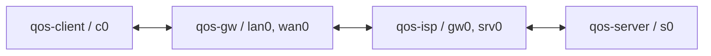
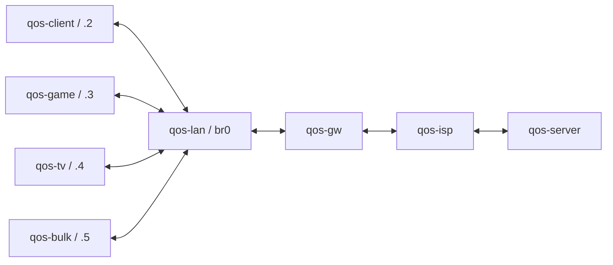

# Step 04: routed IPv4/IPv6 laboratory

[Project README](../README.md) · [Setup](setup.md) · [Development](development.md) · [Checklist](implementation-checklist.md#step-04)

The lab runner creates real Linux network namespaces and veth links inside the dedicated Ubuntu VM. It configures static IPv4/IPv6 routing, enables forwarding only in the two router namespaces, and verifies endpoint delivery. ISP rate limits and QoS policies are later steps; the `emulator` fields are not applied by this runner.

## Topologies and addresses

The initial [lab.yaml](../configs/lab.yaml) creates four namespaces:



| Link | First endpoint | Second endpoint | IPv6 network |
| --- | --- | --- | --- |
| Client-gateway | client `10.10.0.2/24` | gateway LAN `10.10.0.1/24` | `fd42:ad:10::/64` |
| Gateway-ISP | gateway WAN `10.20.0.1/30` | ISP `10.20.0.2/30` | `fd42:ad:20::/64` |
| ISP-server | ISP `10.30.0.1/24` | server `10.30.0.2/24` | `fd42:ad:30::/64` |

IPv6 host suffixes correspond to the IPv4 final octet. Client default routes use the gateway's LAN address. Gateway defaults use the ISP's middle-link address. The ISP has explicit return routes to the client subnet; the server defaults to the ISP. All addressing, routes, router roles and verification endpoints are explicit configuration.

The expanded [lab-multi.yaml](../configs/lab-multi.yaml) creates eight namespaces and seven veth pairs:



`qos-lan` is an unnumbered layer-2 bridge, not a third router. Its five bridge ports have no IP addresses. Four client namespaces retain separate IPv4/IPv6 identities and their own default routes. The device names describe intended future synthetic workloads; this step does not create call, game or TV traffic generators.

## Prerequisites and commands

Use the existing project VM, its installed application `.venv`, and the [source snapshot workflow](development.md). The new shell entry points use that VM-local Python environment, not Windows Python or the standalone preflight's system Python.

From `/opt/adaptive-qos` in Ubuntu:

```bash
sudo bash lab/up.sh
sudo bash lab/inspect.sh
sudo bash lab/verify.sh
sudo bash lab/down.sh
```

After the single-client lab is down, select the multi-device configuration:

```bash
sudo bash lab/up.sh --config configs/lab-multi.yaml
sudo bash lab/inspect.sh
sudo bash lab/verify.sh
sudo bash lab/down.sh
```

Successful commands write JSON to stdout. Preserve reports with ordinary-user shell redirection:

```bash
mkdir -p work/lab
sudo bash lab/inspect.sh > work/lab/inspection.json
sudo bash lab/verify.sh > work/lab/verification.json
```

`up` refuses an existing journal or a collision with any configured namespace. Run `inspect`, then `down`, before switching configurations. A second `down` is a successful no-op. Missing journals are not permission to delete namespace names by prefix.

## What inspection and verification establish

Inspection includes every owned namespace's inode/device identity, addresses, interface byte counters, routes, forwarding settings, queue state and process inventory. It reads the saved configuration, so changing `lab.yaml` after startup cannot silently change cleanup targets.

Verification first checks configured addresses, interface/loopback state, routes, forwarding roles and bridge membership. It then performs IPv4 and IPv6 pings and an upload plus download TCP transfer for every configured client. Each transfer must deliver at least 1 MiB as reported by iperf3's receiver; raw client and server JSON are retained. Download uses iperf3 reverse mode. Router RX/TX byte counters must increase on all four transit interfaces.

These short transfers prove routed delivery, not sustained throughput accuracy, fairness, application recognition, delay improvement or recovery timing. The reports explicitly identify their step-04 scope. The later independent ISP stage will introduce rate changes and experiment ground truth.

## Ownership and failure behavior

The runner stores a root-owned, private journal under `/run/adaptive-qos-lab`, uses a nonblocking operation lock, and records the current boot and each successfully created namespace's inode/device identity. A private bind mount pins each owned namespace across command invocations: without a live reference, Linux can recycle an inode after deletion. Cleanup compares the name with that pinned identity and releases the pin only after removing the name. Link aliases include the run ID. Commands use fixed argument lists; configuration is not interpolated into shell code.

- A name collision fails before any namespace is created.
- A partial setup failure attempts cleanup of acquired namespaces.
- A changed namespace identity stops cleanup before deletion; a replacement namespace is not claimed by its old name.
- Cleanup attempts the remaining owned namespaces even if one deletion fails. The journal remains for retry.
- The verifier tracks its temporary iperf3 server by PID and process start time, and normally stops/reaps it before returning.
- Cleanup refuses untracked processes. Stop manually launched workloads yourself, then rerun `down`; unrelated processes are not killed.

An abrupt power loss or forced kill between namespace creation and journaling can leave an unclaimed name. Setup will refuse the collision. Inspect the exact resource and its provenance before manual reconciliation. The journal is under `/run` and normally disappears on reboot; persistent boot recovery belongs to later service design. This is a dedicated development lab, not a production privilege boundary.

No interface, route, firewall or forwarding sysctl is configured in the VM's initial network namespace. The integration tests compare those host settings before and after the run and retain an unrelated sentinel namespace throughout testing. Namespaces share the VM kernel and CPU, so this lab does not model independent physical-router CPU costs.

## Tests

Ordinary tests exercise configuration and failure/ownership logic without root:

```bash
.venv/bin/python -m pytest
```

Real packet-path tests are explicitly opt-in and require a clean lab in the dedicated VM:

```bash
sudo env AQOS_RUN_LAB_INTEGRATION=1 .venv/bin/python -m pytest tests/integration/test_routed_lab.py -ra
```

They run both configurations twice, verify IPv4/IPv6 upload/download, reject duplicate setup, preserve a pre-existing namespace, inject a setup failure, detect missing routes and disabled forwarding, protect a replacement namespace, and refuse deletion while an untracked workload runs. Raw JSON reports are saved under ignored `work/step04/integration/`.

## Primary command references

Linux documents namespace lifecycle in [ip-netns](https://man7.org/linux/man-pages/man8/ip-netns.8.html), interface/bridge operations in [ip-link](https://man7.org/linux/man-pages/man8/ip-link.8.html), and ESnet documents client/server and reverse transfers in [iperf3 invocation](https://software.es.net/iperf/invoking.html). The verification record identifies the actually installed tool versions.
